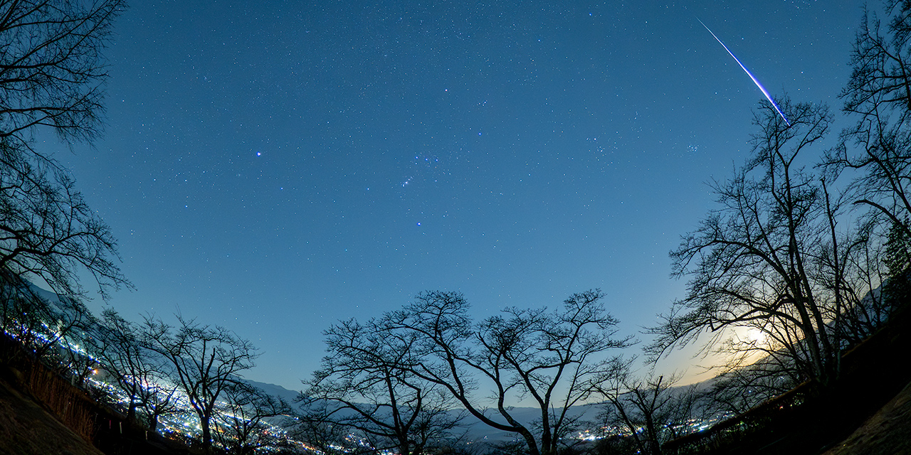

# Detect Meteors CLI

[日本語版](README_ja.md)



[](https://github.com/shin3tky/detect_meteors/actions/workflows/python-test.yml)

Automatically extract meteor candidates from consecutive RAW astrophotography images using frame-to-frame difference analysis. Review the candidates manually to confirm meteors.

## Motivation

During meteor shower events, manually reviewing thousands of RAW images to find meteors is tedious and time-consuming. This tool automates the initial detection process, allowing astrophotographers to quickly identify candidate images for further review.


📅 **Planning your meteor photography?** Check out the [Meteor Showers Calendar](https://github.com/shin3tky/detect_meteors/wiki/Meteor-Showers-Calendar) for upcoming meteor shower dates and viewing tips.

🌠 **November 2026:** See [Meteor Showers 2026 — November](https://github.com/shin3tky/detect_meteors/wiki/Meteor-Showers-2026#november-2026).

> [!TIP]
> If a visually confirmed meteor was missed, [inspect the original pair and settings](docs/COMMAND_OPTIONS.md#read-only-image-analysis-v1611) before changing thresholds.

## Features

- **Fully automated**: NPF Rule-based optimization analyzes EXIF metadata and scientifically tunes detection parameters
- **Field-tested**: Reported 100% detection rate on the project's real-world test dataset (OM Digital OM-1, 1000+ RAW images); results depend on shooting conditions and parameters
- **RAW format support**: Collects the extensions listed in [`meteor_core/schema.py`](meteor_core/schema.py) and decodes them with [`rawpy`](https://github.com/letmaik/rawpy); camera support depends on LibRaw
- **Intelligent processing**: ROI masking, Hough transform line detection, resumable batch processing
- **High performance**: ~0.18 sec/image with multi-core parallel processing

## Requirements

- Python 3.12, 3.13
- macOS, Windows, or Linux
- Dependencies: `numpy`, `opencv-python`, `rawpy`, `psutil`, `pillow`, `pydantic`, `pyyaml`

Exact versions: [installation guide](docs/INSTALL.md#dependency-versions-v1611).

## Installation

See [INSTALL.md](docs/INSTALL.md) for detailed installation instructions.

## Quick Start

After installing with `uv sync --locked`, run these commands from the project
root containing `pyproject.toml`. Application examples consistently use
`uv run detect-meteors` (with a hyphen).

### Step 0: Prepare Images

Place the RAW images you want to analyze directly in the `rawfiles/` directory at the project root. Create the directory if it does not exist.
Files are processed in filename order, so use filenames that preserve the shooting sequence.

### Step 1: Check EXIF Metadata

```bash
uv run detect-meteors --show-exif
```

Verify focal length is detected. If missing, you'll need to specify it with `--focal-length`.

### Step 2: Run Detection

```bash
# Micro Four Thirds camera
uv run detect-meteors --auto-params --sensor-type MFT

# APS-C camera (Sony/Nikon/Fuji)
uv run detect-meteors --auto-params --sensor-type APS-C

# Full Frame camera
uv run detect-meteors --auto-params --sensor-type FF

# With fisheye lens
uv run detect-meteors --auto-params --sensor-type MFT --focal-length 16 --fisheye
```

> [!IMPORTANT]
> Detection is based on frame-to-frame differences.  
> If you provide **N** RAW files, the tool analyzes **N−1** consecutive pairs (the **first frame is used as the baseline** and is not scored).  
> This is why “100 inputs → 99 processed” is expected—please review the first frame manually.

### Step 3: Review Candidates

Check the `candidates/` folder for detected meteor images.

### Inspect a Missed Candidate (v1.6.11)

Supply a visually confirmed missed meteor, its preceding image, and the original
progress file to see effective settings, their sources, and rejection reasons:

```bash
uv run detect-meteors \
  --analyze-image rawfiles/frame002.ORF \
  --reference-image rawfiles/frame001.ORF \
  --analysis-progress previous_run/progress.json
```

This mode leaves candidates and progress untouched. `--verbose` shows contours
and lines; `--tune-params` proposes bounded adjustments. Use an explicit
`--analysis-sequence DIR` instead of `--reference-image` to select the preceding
RAW by filename order. A missing reference reports `reference_missing` and exits
with status 2 without a decision.

#### Try Tuning with the Repository Sample

From a repository checkout, this example deliberately raises the aspect-ratio
threshold to create a missed candidate, then proposes a relaxation:

```bash
uv run detect-meteors \
  --analyze-image rawfiles/2024GEMINI_AIRCRAFT/_C140338.ORF \
  --reference-image rawfiles/2024GEMINI_AIRCRAFT/_C140337.ORF \
  --diff-threshold 9 --min-area 3 --min-line-score 30 \
  --min-aspect-ratio 20 --no-roi --tune-params
```

These values demonstrate the workflow; they are not camera or lens presets.
The sample contains aircraft as well as a confirmed meteor: recovering a
candidate frame does not identify which trail passed. RAW samples are available
in the repository and excluded from Python distributions.

Add `--analysis-output analysis/review-001` to save a JSON report and PNG evidence
to a **new** directory. After reviewing the proposals, rerun with the same options
and `--analysis-proposal 1` plus a fresh output directory to export the first
returned proposal as `session.yaml`. Run normal detection separately with
`uv run detect-meteors --config DIR/session.yaml`; outputs go under
`DIR/run`. Proposals are never applied automatically.

For sequence comparison, known-meteor labels, search limits, and ROI overrides,
see the [analysis options](docs/COMMAND_OPTIONS.md#read-only-image-analysis-v1611)
and [release notes](docs/RELEASE_NOTES_1.6.md#version-1611-2026-11-07).

## Available Sensor Types

| Sensor Type | Description |
|-------------|-------------|
| `1INCH` | 1-inch sensor |
| `MFT` | Micro Four Thirds |
| `APS-C` | APS-C (Sony/Nikon/Fuji) |
| `APS-C_CANON` | APS-C (Canon) |
| `APS-H` | APS-H |
| `FF` | Full Frame 35mm |
| `MF44X33` | Medium Format 44×33mm |
| `MF54X40` | Medium Format 54×40mm |

List all presets: `uv run detect-meteors --list-sensor-types`

## Inputs and Outputs

- **Input**: Directory of RAW images (default: `rawfiles/`)
  - Files are sorted by filename, not EXIF capture time. Use filenames that preserve the shooting sequence.
  - The built-in RAW loader averages each 2×2 block of sensor pixels into one `uint16` pixel; only `binning: 2` is supported.
- **Output**: 
  - Candidate images in `candidates/` (or custom `-o` path)
  - Optional debug masks with `--debug-image` and `--debug-dir`
  - `progress.json` for resumable processing

The default `hough` detector computes the absolute difference between adjacent
frames, thresholds it, applies the ROI and a morphological opening, then checks
contour area/aspect ratio and the summed length of Hough line segments. These
are candidate-selection heuristics; ML classification is planned in the roadmap.
ROI coordinates and detection lengths/areas refer to the binned image.

## Configuration Files (YAML/JSON)

The CLI can load pipeline settings from a configuration file. The file must be a
JSON or YAML object whose keys align with `PipelineConfig`.
Partial configurations are supported by the CLI and `load_pipeline_config()`;
omitted fields use built-in defaults. Relative paths are resolved from the
current working directory, not from the configuration file's directory.

**Top-level keys**

- `target_folder`, `output_folder`, `debug_folder` (default: `rawfiles`, `candidates`, `debug_masks`)
- `params` (detection parameters)
- `roi_polygon`, `enable_roi_selection` (configured ROI and interactive selection)
- `num_workers`, `batch_size`, `auto_batch_size`, `enable_parallel`
- `progress_file`, `output_overwrite`
- `input_loader_name`, `input_loader_config`
- `detector_name`, `detector_config`
- `output_handler_name`, `output_handler_config`
- `hooks` (ordered list of hook names/configurations; default: no hooks)
- `hook_error_mode` (`raise` or `warn`; default: `raise`)

**Example (YAML)**

```yaml
target_folder: ./rawfiles
output_folder: ./candidates
debug_folder: ./debug_masks
params:
  diff_threshold: 8
  min_area: 10
  min_aspect_ratio: 3.0
input_loader_name: raw
input_loader_config:
  binning: 2
  normalize: true
detector_name: hough
output_handler_name: file
```

The RAW loader defaults to `normalize: false`; `true` returns `float32` pixels
in [0, 1], and the pipeline scales `diff_threshold` accordingly. The built-in
Hough detector uses `params` for its thresholds and accepts an empty
`detector_config`. The file output handler uses `output_overwrite`, not
`overwrite`, for overwrite control.

When `output_handler_name: file` is explicitly selected, set output paths and
overwrite behavior in `output_handler_config`; its own defaults are used for
omitted fields. To inherit the top-level `output_folder`, `debug_folder`, and
`output_overwrite`, omit `output_handler_name` and use the default file handler.

**Example file**: [`config_examples/pipeline.yaml`](config_examples/pipeline.yaml)

**Usage (CLI)**

```bash
uv run detect-meteors --config config_examples/pipeline.yaml
```

You can override plugin selections via CLI (e.g., `--input-loader`, `--detector`,
`--output-handler`) and provide plugin configs as JSON/YAML strings or file paths.
Legacy parameter flags (e.g., `--diff-threshold`) are still mapped into
`PipelineConfig.params`; normal runs warn that these legacy flags are deprecated
in favor of config files. For normal-run config overrides, use full option names
and separate values (for example, `--diff-threshold 12`); see the
[syntax limitation](docs/COMMAND_OPTIONS.md#normal-run-override-syntax).

**Usage (Python)**

```python
from meteor_core import MeteorDetectionPipeline, load_pipeline_config

config = load_pipeline_config("config_examples/pipeline.yaml")
pipeline = MeteorDetectionPipeline(config)
pipeline.run()
```

## Resumable Processing

- Interrupt with Ctrl-C anytime
- Resume by running the same command again
- Use `--no-resume` for a fresh start

### Aircraft Trail Analysis (Optional)

Enable the built-in hook to annotate candidates with aircraft trail likelihood:

```bash
uv run detect-meteors --hooks aircraft_trail --no-roi
```

The hook tracks line geometry in frame order after processing completes and
writes an `aircraft` block into candidate entries in `progress.json`'s
`detected_details`. It preserves candidate decisions, scores, and copied RAW
files. The likelihood is a heuristic score, not a calibrated probability.
On resume, analysis covers only frames processed in the current invocation;
cross-frame tracks are not restored from previous progress. See the
[implementation notes](docs/aircraft_light_trails_hook_design.md) for configuration
and limitations.

For a reproducible local example, use
[`config_examples/aircraft_trail_sample.yaml`](config_examples/aircraft_trail_sample.yaml):

```bash
uv run detect-meteors \
  --config config_examples/aircraft_trail_sample.yaml \
  --no-roi --no-resume --debug-image
```

The Git-tracked 12-frame sample contains aircraft in every image and owner-confirmed
meteors in `_C140338.ORF` and `_C140344.ORF`. All 11 analyzed pairs remain
candidates; the hook is not an aircraft rejection filter. The latter meteor
frame also receives high aircraft likelihood with the sample settings, so keep
reviewing mixed images. The RAW files and checksums are available in
[`rawfiles/2024GEMINI_AIRCRAFT`](rawfiles/2024GEMINI_AIRCRAFT/README.md) in a
repository checkout; RAW images are excluded from the Python distributions. See the
[usage and result-reading guide](docs/aircraft_light_trails_hook_design.md#read-the-results)
and [sample validation results](docs/aircraft_sample_validation.md).

## Documentation

| Document | Description |
|----------|-------------|
| [COMMAND_OPTIONS.md](docs/COMMAND_OPTIONS.md) | Complete CLI options reference |
| [NPF_RULE.md](docs/NPF_RULE.md) | NPF Rule and focal length handling |
| [INSTALL.md](docs/INSTALL.md) | Installation guide |
| [INSTALL_DEV.md](docs/INSTALL_DEV.md) | Developer setup |
| [PLUGIN_AUTHOR_GUIDE.md](docs/PLUGIN_AUTHOR_GUIDE.md) | Plugin development |
| [Aircraft trail guide](docs/aircraft_light_trails_hook_design.md) | Enable, configure, and inspect aircraft metadata |
| [Aircraft sample validation](docs/aircraft_sample_validation.md) | Results and limitations on the local 12-frame sequence |
| [Wiki](https://github.com/shin3tky/detect_meteors/wiki) | Technical details |

## What's New in v1.6.11

**Release date: November 7, 2026 (2026-11-07).**

- Consolidate the 1.6 detection foundation and propagate parallel save errors like sequential errors.
- Update runtime/development dependencies, including [upstream security fixes](docs/CHANGELOG.md#security-updates-1611).
- Inspect missed candidates with the original image pair, recorded settings, and ROI.
- Derive bounded tuning proposals and compare their effects on a shooting sequence.
- Save JSON/PNG evidence and an explicitly selected session configuration for reprocessing.
- Reuse configured ROI and complete analysis options in Bash/Zsh, including `detect-meteors`.

See the [release notes](docs/RELEASE_NOTES_1.6.md#version-1611-2026-11-07)
for the workflow and [CHANGELOG](docs/CHANGELOG.md#v1611---2026-11-07) for all changes.

### Previous Releases

| Version | Highlights | Details |
|---------|------------|---------|
| v1.6.x | Schema versioning, ML-ready architecture, uv/Ruff toolchain | [RELEASE_NOTES_1.6.md](docs/RELEASE_NOTES_1.6.md) |
| v1.5.x | Plugin architecture, sensor presets, fisheye support | [RELEASE_NOTES_1.5.md](docs/RELEASE_NOTES_1.5.md) |
| v1.4.x | NPF Rule optimization, EXIF extraction | [RELEASE_NOTES_1.4.md](docs/RELEASE_NOTES_1.4.md) |
| v1.3.x | Auto-parameter estimation | [RELEASE_NOTES_1.3.md](docs/RELEASE_NOTES_1.3.md) |
| v1.2.x | Threshold estimation improvements | [RELEASE_NOTES_1.2.md](docs/RELEASE_NOTES_1.2.md) |

See [CHANGELOG.md](docs/CHANGELOG.md) for complete release history.

## Roadmap

See [ROADMAP.md](docs/ROADMAP.md) for upcoming features.

## Authors

Detect Meteors CLI was created by Shinichi Morita (shin3tky).

The NPF Rule implementation is based on the formula developed by Frédéric Michaud of the Société Astronomique du Havre (SAH). See [NOTICE](NOTICE) for full attribution.

## Contributing

Issues and pull requests are welcome. Please open an issue to discuss substantial changes before submitting a PR.

For development setup, see [INSTALL_DEV.md](docs/INSTALL_DEV.md).

## License

This project is licensed under the [Apache License 2.0](LICENSE).
