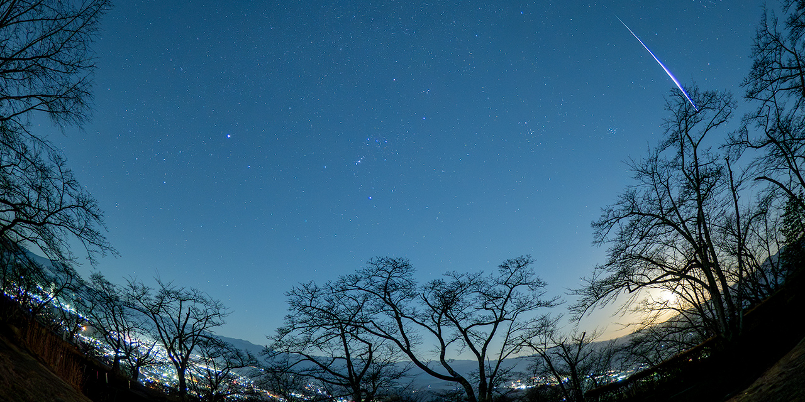

# Detect Meteors CLI

[English](README.md)



[](https://github.com/shin3tky/detect_meteors/actions/workflows/python-test.yml)

連続撮影した星空のRAW画像から、フレーム間差分を使って流星候補を自動抽出します。流星かどうかは候補画像を目視で確認してください。

## 開発の背景

流星群の撮影では、数千枚のRAW画像を手作業で確認して流星を探すのに多くの時間がかかります。このツールは最初の候補抽出を自動化し、詳しく確認する画像を素早く絞り込めるようにします。


📅 **流星撮影を計画していますか？** 今後の流星群の日程や観測のヒントは、[流星群カレンダー](https://github.com/shin3tky/detect_meteors/wiki/Meteor-Showers-Calendar)を参照してください。

🌠 **2026年11月の流星群**：[Meteor Showers 2026（11月）](https://github.com/shin3tky/detect_meteors/wiki/Meteor-Showers-2026#november-2026)を参照してください。

> [!TIP]
> 目視で確認した流星が候補に入らなかったときは、閾値を変える前に[元の画像ペアと設定を確認](docs/COMMAND_OPTIONS.md#read-only-image-analysis-v1611)できます。

## 特徴

- **自動調整**：NPF Ruleに基づきEXIFメタデータを解析し、検出パラメータを科学的に調整します。
- **実画像での検証**：プロジェクトの実画像テストデータ（OM Digital OM-1、1,000枚以上のRAW画像）では検出率100%を報告しています。結果は撮影条件やパラメータによって変わります。
- **RAW形式への対応**：[`meteor_core/schema.py`](meteor_core/schema.py)に列挙した拡張子を収集し、[`rawpy`](https://github.com/letmaik/rawpy)で読み込みます。カメラへの対応はLibRawに依存します。
- **画像処理と再開機能**：ROIによる領域の絞り込み、Hough変換による線分検出、中断後に再開できるバッチ処理に対応します。
- **高速処理**：マルチコア並列処理で、1画像あたり約0.18秒の処理実績があります。

## 動作要件

- Python 3.12、3.13
- macOS、Windows、Linux
- 依存ライブラリ：`numpy`、`opencv-python`、`rawpy`、`psutil`、`pillow`、`pydantic`、`pyyaml`

固定バージョンは[インストールガイド](docs/INSTALL_ja.md#dependency-versions-v1612)を参照してください。

## インストール

[最新リリース v1.6.12](https://github.com/shin3tky/detect_meteors/releases/tag/1.6.12)をダウンロードし、[インストールガイド](docs/INSTALL_ja.md)に沿って導入してください。

## クイックスタート

`uv sync --locked` で導入した後、`pyproject.toml` のあるプロジェクトルートで実行してください。
アプリの起動例は `uv run detect-meteors` に統一しています。コマンド名にはハイフンを使います。

### 手順0：画像を準備する

解析するRAW画像を、プロジェクトルートの `rawfiles/` ディレクトリ直下に配置してください。ディレクトリがない場合は作成してください。
ファイル名順に処理されるため、撮影順を維持できるファイル名を使ってください。

### 手順1：EXIFメタデータを確認する

```bash
uv run detect-meteors --show-exif
```

焦点距離が取得できていることを確認します。取得できない場合は、`--focal-length` で指定してください。

### 手順2：検出を実行する

```bash
# Micro Four Thirds camera
uv run detect-meteors --auto-params --sensor-type MFT

# APS-C camera (Sony/Nikon/Fuji)
uv run detect-meteors --auto-params --sensor-type APS-C

# Full Frame camera
uv run detect-meteors --auto-params --sensor-type FF

# With fisheye lens
uv run detect-meteors --auto-params --sensor-type MFT --focal-length 16 --fisheye
```

> [!IMPORTANT]
> 検出にはフレーム間差分を使用します。  
> **N枚**のRAWファイルから、連続する **N−1組**を解析します。**最初の画像は基準フレームとして使い、検出の評価対象にはしません。**  
> このため「入力100枚 → 処理99組」は正常です。最初の画像は手動で確認してください。

### 手順3：候補を確認する

`candidates/` フォルダーに保存された流星候補画像を確認してください。

### 取りこぼし画像の確認（v1.6.11）

目視で流星を確認したのに候補へ入らなかった場合は、対象画像と直前画像、元の進捗を指定します。
実効設定、値の出所、不採用の条件を確認できます。

```bash
uv run detect-meteors \
  --analyze-image rawfiles/frame002.ORF \
  --reference-image rawfiles/frame001.ORF \
  --analysis-progress previous_run/progress.json --locale ja
```

候補コピーや進捗更新は行いません。`--verbose` で輪郭と線分の詳細を表示し、
`--tune-params` で範囲を限定した調整案を生成します。`--reference-image` の代わりに
`--analysis-sequence DIR` を使うと、明示した系列のファイル名順で直前RAWを選択します。
参照がない場合は `reference_missing` と終了コード2を返し、判定しません。

#### 同梱サンプルで調整を試す

リポジトリのルートで次を実行できます。比率閾値を意図的に高くして取りこぼしを作り、
実測値に基づく緩和案を確認する例です。

```bash
uv run detect-meteors \
  --analyze-image rawfiles/2024GEMINI_AIRCRAFT/_C140338.ORF \
  --reference-image rawfiles/2024GEMINI_AIRCRAFT/_C140337.ORF \
  --diff-threshold 9 --min-area 3 --min-line-score 30 \
  --min-aspect-ratio 20 --no-roi --tune-params --locale ja
```

数値は動作例であり、カメラやレンズの推奨値ではありません。このサンプルには確認済み流星と
飛行機が映っています。候補フレームになったことと、その流星を検出したことは区別してください。
RAWサンプルはリポジトリに収録され、Python配布物には含まれません。

`--analysis-output analysis/review-001` を追加すると、**新規**フォルダーへJSONレポートと
PNGの証拠画像を保存します。案を確認した後、同じオプションに `--analysis-proposal 1` を付け、
別の新規出力先で再実行すると、先頭の調整案を `session.yaml` に保存できます。
採用時は `uv run detect-meteors --config DIR/session.yaml` で通常検出を実行します。
出力先は `DIR/run` です。調整案は自動適用しません。

系列比較、既知流星の指定、探索上限、ROIの変更は
[オプション一覧](docs/COMMAND_OPTIONS.md#read-only-image-analysis-v1611)と
[リリースノート](docs/RELEASE_NOTES_1.6_ja.md#バージョン16112026-11-07)を参照してください。

## 対応するセンサータイプ

| センサータイプ | 説明 |
|----------------|------|
| `1INCH` | 1型センサー |
| `MFT` | マイクロフォーサーズ |
| `APS-C` | APS-C（Sony/Nikon/Fuji） |
| `APS-C_CANON` | APS-C（Canon） |
| `APS-H` | APS-H |
| `FF` | 35mmフルサイズ |
| `MF44X33` | 中判44×33mm |
| `MF54X40` | 中判54×40mm |

プリセット一覧：`uv run detect-meteors --list-sensor-types`

## 入力と出力

- **入力**：RAW画像のディレクトリ（既定：`rawfiles/`）
  - EXIFの撮影日時ではなく、ファイル名順に並べます。撮影順を維持できるファイル名を使ってください。
  - 組み込みRAWローダーは、センサー画素の2×2ブロックを平均して1つの `uint16` 画素にします。対応する設定は `binning: 2` のみです。
- **出力**：
  - `candidates/` 内の候補画像（`-o` で別の保存先も指定可能）
  - `--debug-image` と `--debug-dir` による任意のデバッグマスク
  - 処理の再開に使う `progress.json`

既定の `hough` 検出器は、隣接フレームの絶対差分を求め、閾値処理、ROIの適用、モルフォロジーのオープニング処理を行います。その後、輪郭の面積・縦横比と、Hough変換で得た線分の長さの合計を調べます。これらは候補を選ぶためのヒューリスティックです。機械学習による分類はロードマップに含まれています。ROI座標、検出する線分の長さや領域の面積は、ビニング後の画像を基準にします。

## 設定ファイル（YAML/JSON）

パイプラインの設定は、YAML または JSON のファイルにまとめて `--config` で読み込めます。必要な項目だけ書けば、省略した項目には既定値が入ります。相対パスの基準は、コマンドを実行したディレクトリです。

v1.6.12 向けに新しい設定ファイルを作る場合は、最上位に `schema_version: 1` を指定してください。指定がない既存ファイルはバージョン1として読み込みます。未対応の版や整数以外の値を指定すると、設定エラーになります。

**最上位のキー**

- `schema_version`（パイプライン設定ファイル形式の版。省略時は `1`）
- `target_folder`、`output_folder`、`debug_folder`（既定：`rawfiles`、`candidates`、`debug_masks`）
- `params`（検出パラメータ）
- `roi_polygon`、`enable_roi_selection`（保存ROIと対話選択の設定）
- `num_workers`、`batch_size`、`auto_batch_size`、`enable_parallel`
- `progress_file`、`output_overwrite`
- `input_loader_name`、`input_loader_config`
- `detector_name`、`detector_config`
- `output_handler_name`、`output_handler_config`
- `hooks`（実行順に並べたフック名・設定の一覧。既定ではフックなし）
- `hook_error_mode`（`raise` または `warn`。既定：`raise`）

**YAMLの例**

```yaml
schema_version: 1
target_folder: ./rawfiles
output_folder: ./candidates
debug_folder: ./debug_masks
params:
  diff_threshold: 8
  min_area: 10
  min_aspect_ratio: 3.0
input_loader_name: raw
input_loader_config:
  binning: 2
  normalize: true
detector_name: hough
output_handler_name: file
```

RAWローダーの既定値は `normalize: false` です。`true` にすると画素を [0, 1] の範囲の `float32` として返し、パイプラインはそれに合わせて `diff_threshold` を調整します。組み込みHough検出器の閾値は `params` で指定し、`detector_config` には空の設定を渡せます。ファイル出力ハンドラーの上書き制御には、`overwrite` ではなく `output_overwrite` を使います。

`output_handler_name: file` を明示的に選ぶ場合は、保存先と上書き動作を `output_handler_config` で指定してください。省略したフィールドにはハンドラー自身の既定値を使います。最上位の `output_folder`、`debug_folder`、`output_overwrite` を引き継ぐには、`output_handler_name` を省略し、既定のファイルハンドラーを使ってください。

**設定例ファイル**：[`config_examples/pipeline.yaml`](config_examples/pipeline.yaml)

**CLIでの使用例**

```bash
uv run detect-meteors --config config_examples/pipeline.yaml
```

`--input-loader`、`--detector`、`--output-handler` を指定すると、設定ファイルで選んだプラグインを切り替えられます。プラグイン固有の設定は、YAML／JSON の文字列またはファイルのパスで渡せます。通常の検出で `--diff-threshold` など従来のオプションを使うと、値は引き続き反映されますが、設定ファイルの利用を勧める警告が出ます。設定ファイルの値を上書きする場合は、`--diff-threshold 12` のように、オプション名を省略せず、値との間に空白を入れてください。[オプションの書き方](docs/COMMAND_OPTIONS.md#normal-run-override-syntax)も参照してください。

**Pythonでの使用例**

```python
from meteor_core import MeteorDetectionPipeline, load_pipeline_config

config = load_pipeline_config("config_examples/pipeline.yaml")
pipeline = MeteorDetectionPipeline(config)
pipeline.run()
```

## 中断と再開

- Ctrl-Cでいつでも中断できます。
- 同じコマンドを再実行すると再開できます。
- 最初から処理する場合は `--no-resume` を使います。

### 飛行機の光跡解析（任意）

組み込みフックを有効にすると、候補に飛行機の光跡らしさを示す情報を付加します。

```bash
uv run detect-meteors --hooks aircraft_trail --no-roi
```

このフックは処理完了後にフレーム順で線分の形状を追跡し、`progress.json` の `detected_details` にある候補レコードへ `aircraft` 情報を書き込みます。候補判定、スコア、コピー済みRAWファイルは変えません。likelihoodはヒューリスティックなスコアであり、校正された確率ではありません。
再開時に解析するのは、その実行で新たに処理したフレームのみです。前回の進捗から追跡状態は復元しません。設定と制約は[実装説明](docs/aircraft_light_trails_hook_design.md)を参照してください。

再現可能なサンプルとして、[`config_examples/aircraft_trail_sample.yaml`](config_examples/aircraft_trail_sample.yaml)を利用できます。

```bash
uv run detect-meteors \
  --config config_examples/aircraft_trail_sample.yaml \
  --no-roi --no-resume --debug-image
```

Gitで管理している12枚のサンプルには、すべて飛行機が映っています。所有者が流星を確認しているのは `_C140338.ORF` と `_C140344.ORF` です。解析する11組はすべて候補として残ります。このフックは飛行機を除外するフィルターではありません。後者の流星画像はサンプル設定で飛行機のlikelihoodも高くなるため、両方が映った画像も目視確認してください。
RAWファイルとチェックサムは、リポジトリの [`rawfiles/2024GEMINI_AIRCRAFT`](rawfiles/2024GEMINI_AIRCRAFT/README.md) にあります。RAW画像はPythonの配布ファイルには含めません。[使い方と結果の読み方](docs/aircraft_light_trails_hook_design.md#read-the-results)、[サンプルの検証結果](docs/aircraft_sample_validation.md)も参照してください。

## ドキュメント

| 文書 | 内容 |
|------|------|
| [COMMAND_OPTIONS.md](docs/COMMAND_OPTIONS.md) | CLIオプションの全リファレンス |
| [NPF_RULE_ja.md](docs/NPF_RULE_ja.md) | NPF Ruleと焦点距離の扱い |
| [INSTALL_ja.md](docs/INSTALL_ja.md) | インストール手順 |
| [INSTALL_DEV_ja.md](docs/INSTALL_DEV_ja.md) | 開発環境の構築 |
| [PLUGIN_AUTHOR_GUIDE_ja.md](docs/PLUGIN_AUTHOR_GUIDE_ja.md) | プラグインの開発 |
| [飛行機の光跡ガイド](docs/aircraft_light_trails_hook_design.md) | フックの有効化、設定、メタデータの確認 |
| [飛行機サンプルの検証](docs/aircraft_sample_validation.md) | 12枚のサンプルでの結果と制約 |
| [Wiki](https://github.com/shin3tky/detect_meteors/wiki) | 技術的な詳細 |

## v1.6.12 の主な変更

**2026年11月11日公開。**

- 並列処理でも、メインプロセスと同じプラグインと変換関数を使います。
- 検出器が未対応の形式で結果を返した場合は、プラグインを直してから再開すると、問題のペアを再処理できます。フックの不正な戻り値は既存の `warn`／`raise` に従います。
- パイプライン設定が `schema_version: 1` に対応しました。版の指定がない既存設定も読み込めます。新しく書き出すセッション設定には版が付きます。

詳しくは[リリースノート](docs/RELEASE_NOTES_1.6_ja.md#version-1612)と[変更履歴](docs/CHANGELOG_ja.md#v1612)を参照してください。

### 以前のリリース

| バージョン | 主な変更 | 詳細 |
|------------|----------|------|
| v1.6.11 | 取りこぼしの分析、パラメータ調整、セッション設定の再利用 | [リリースノート](docs/RELEASE_NOTES_1.6_ja.md#バージョン16112026-11-07) |
| v1.6.x | スキーマのバージョン管理、MLに備えた設計、uv/Ruff開発環境 | [RELEASE_NOTES_1.6_ja.md](docs/RELEASE_NOTES_1.6_ja.md) |
| v1.5.x | プラグイン構成、センサープリセット、魚眼対応 | [RELEASE_NOTES_1.5.md](docs/RELEASE_NOTES_1.5.md) |
| v1.4.x | NPF Ruleによる最適化、EXIF抽出 | [RELEASE_NOTES_1.4.md](docs/RELEASE_NOTES_1.4.md) |
| v1.3.x | パラメータの自動推定 | [RELEASE_NOTES_1.3.md](docs/RELEASE_NOTES_1.3.md) |
| v1.2.x | 閾値推定の改善 | [RELEASE_NOTES_1.2.md](docs/RELEASE_NOTES_1.2.md) |

全リリース履歴は[CHANGELOG_ja.md](docs/CHANGELOG_ja.md)を参照してください。

## ロードマップ

今後の機能は[ROADMAP.md](docs/ROADMAP.md)を参照してください。

## 作者

Detect Meteors CLIの作者はShinichi Morita（shin3tky）です。

NPF Ruleの実装は、Société Astronomique du Havre（SAH）のFrédéric Michaud氏が開発した数式に基づきます。帰属情報の詳細は[NOTICE](NOTICE)を参照してください。

## 貢献

IssueやPull Requestを歓迎します。大きな変更は、先にIssueを作成して相談してください。

開発環境の構築は[INSTALL_DEV_ja.md](docs/INSTALL_DEV_ja.md)を参照してください。

## ライセンス

このプロジェクトは[Apache License 2.0](LICENSE)で公開しています。
