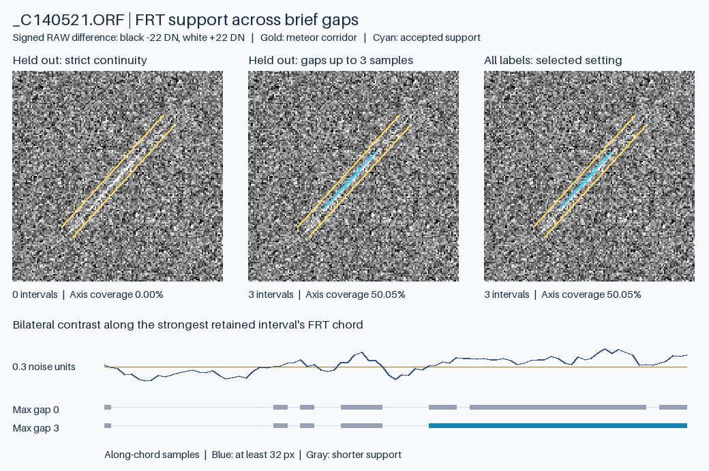

# 短い途切れを含むFRT支持区間の検証

[前回の系列除外評価](frt_foreground_verification_ja.md)では、正の差分ハフとFRT検証で
流星5枚の軸が一致し、偽陽性は0枚だった。残る `_C140521.ORF` について、直前の
`_C140520.ORF` との差分とFRT候補線分を固定し、設定によって光跡のどこが残るか調べた。

## 2024GEMINI後半を除外すると落ちる理由



FRT得点の最低値を10とした従来の方式では、全ラベルで選んだ設定と2024GEMINI後半を
除外して選んだ設定の違いは、支持区間内で許す途切れだけだった。両側コントラスト下限は
0.3雑音単位、最小支持長は32 px、直前RAWの局所凹凸上限は0.8雑音単位、FRT得点下限は10だった。

| 設定選択 | 許容する途切れ | 注釈軸と重なる最長支持区間 | 全条件を通る区間 | 注釈軸被覆 |
| --- | ---: | ---: | ---: | ---: |
| 2024GEMINI後半を除外 | 0標本 | 28.63 px | 0本 | 0% |
| 全ラベルを使用 | 最大3標本 | 37.84 px | 3本 | 50.0536% |

途切れを許すと37.84、34.55、33.33 pxの3区間が残る。FRT得点はそれぞれ13.61、
13.27、12.77で、直前RAWの局所凹凸は0.57〜0.58雑音単位だった。区間の重複を除いた
注釈軸被覆は50%の判定基準を0.0536ポイント上回った。得点の余裕を優先する従来方式は、
2024GEMINI後半を除外すると下限を18.481に設定した。途切れだけを緩めても、その下限では
3区間とも棄却された。
[線分座標、条件ごとの判定、代表線分のプロファイル](../experiments/region_comparison/results/frt_c140521/c140521_gates.json)

## 121ペアでの系列除外評価

前回と同じ121ペア・同じFRT候補線分を使い、各系列を順に外して残り2系列だけで設定を
選んだ。正の差分ハフの採用3枚を保持し、棄却した118ペアをFRTで検証した。
従来の選択は、学習側で軸が一致した枚数とFRT得点下限が同じ場合、途切れ0標本を優先する。
追試では、この設定を出発点に途切れだけを0から最大3標本に変更し、学習側の偽陽性が
0枚で、すでに一致していた軸の被覆を保ち、少なくとも1枚の一致軸の被覆が増える場合に採用した。
2024GEMINI後半を外した回では、学習側の `_C150319.ORF` の軸被覆が56.09%から90.18%に
上がったため、緩和が採用された。

| 方式 | 軸が一致した流星 | 偽陽性 |
| --- | ---: | ---: |
| 従来の選択（FRT得点の最低値10） | 5/6 | 0/115 |
| 学習側で得点の余裕を優先 | 5/6 | 0/115 |
| 同じ一致枚数と得点下限なら学習側の軸被覆合計を優先 | 5/6 | 0/115 |
| 途切れだけの緩和を学習側で検証 | **6/6** | **0/115** |

軸被覆合計を優先する方式では、2024GEMINI後半を外した回の最小支持長が45 pxに
上がり、`_C140521.ORF` の最長37.84 pxの区間は届かなかった。途切れだけの緩和では、
既存5枚の軸被覆をすべて維持した。系列別では、同梱の航空機サンプルで2/2・偽陽性0/9、
2021GEMINIで3/3・0/32、2024GEMINI後半で1/1・0/74だった。

緩和の採用と閾値の選択には各評価系列を使っていない。緩和の方法自体は同じ121ペアの
診断をもとに設計した。今回追加回収した1枚の被覆は判定基準に近い。
[系列ごとの設定、候補、軸被覆](../experiments/region_comparison/results/frt_c140521/background_verification.json)

[既存ワークフローでの設定と再現結果](frt_retry_workflow_ja.md)

## 再現

リポジトリのルートで実行する。`--raw-root` にはRAWの配置先を指定する。

```bash
run_dir=$(mktemp -d)
raw_root=../detect_meteors_assets/rawfiles
PYTHONPATH=. uv run --locked python experiments/region_comparison/benchmark_hough_frt_retry.py \
  "$run_dir/frt" --raw-root "$raw_root" --workers 3 --save-proposals
PYTHONPATH=. uv run --locked python experiments/region_comparison/benchmark_frt_foreground.py \
  "$run_dir/frt" "$run_dir/foreground" --raw-root "$raw_root" --workers 3
PYTHONPATH=. uv run --locked python experiments/region_comparison/review_frt_c140521.py \
  "$run_dir/frt" "$run_dir/foreground" "$run_dir/review" --raw-root "$raw_root"
```
