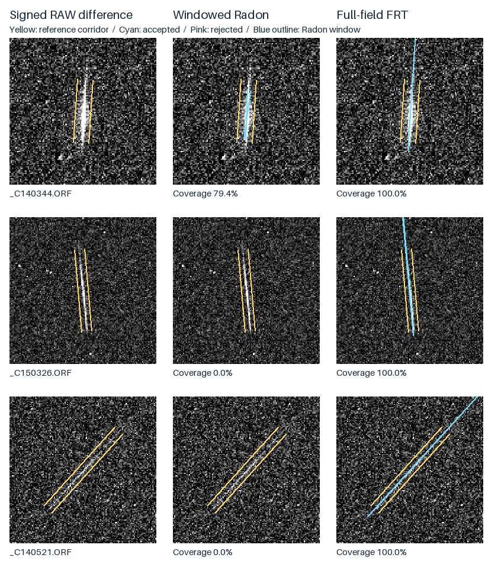
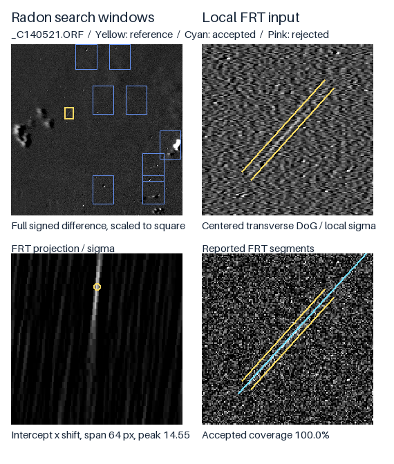

# 雑音正規化を用いた全画面FRTと限定ラドンの比較

2026年11月21日 · Detect Meteors `feature/2_0_1`

全露光の目視ラベルを用いた適合率・再現率と、他方式と計測条件をそろえた結果は[後続の再評価](v2_detection_evaluation_ja.md)に示す。以下には全画面FRTの初回比較を記録する。

## 目的

探索窓を応答値で選ぶ現行の限定ラドンでは、弱い光跡が選外の窓にあれば投影に進まない。全画面を対象に、短い有限線分に沿う積算を局所雑音で正規化することで、淡い光跡の被覆と事象単位の一致が改善するかを調べた。後半区間の `_C140521.ORF` では、参照軸の絶対値差分コントラストが5 DNであり、前回の固定条件では光跡が一致しなかった。[前回の比較記録](detector_comparison_2.0.1_ja.md)

## 実装

| 段階 | 限定ラドン `radon` | 全画面FRT `frt` |
| --- | --- | --- |
| 差分 | 絶対値差分の2次元DoGから6 DNを引き、0〜70 DNに制限 | 符号付き差分に、積算軸に直交する方向だけのDoGを適用。標準偏差は1・3 px |
| 探索領域 | 256 px角の上位8タイルと周囲32 px | 全画面ROI。積算方向を縦・横に分け、縦横のどちらかを主軸とする全ての離散方向を走査 |
| 積算 | 窓ごとに2°刻みで回転し、隣接3行の和を計算 | 16・32・64・128・256標本の有限区間。半区間ずつずらした開始位置で、上下半分の積算結果をシフトして再利用 |
| 線分の選び方 | 窓ごとに最大6ピーク、支持区間をピークごとに最大2本 | 区間ごとの傾き・切片平面で局所最大を取り、切片96 px幅あたり上位3本を残す。診断用のピーク抽出下限は5 |
| 採用条件 | 長さ15 px以上、ROI内、中央帯と側帯のコントラスト15 DN以上 | 長さ15 px以上、積算区間の75%以上が有効で途中にROIの欠損がないこと、雑音正規化得点8以上、原差分の正の画素率65%以上 |

FRTは、区間の上下半分の積算を傾きに応じてずらして足す動的計画法である。区間長を倍にするたびに、小さい区間で求めた積算を再利用する。画像を転置した同じ処理で、もう一方の主軸を走査する。原著の短い光跡向けの考え方に沿って、全画像の同じ固定長を積算する代わりに、複数尺度の途中結果を検出に用いた。窓を応答の強さで事前選別する処理はない。開始位置は半区間刻みで、投影面のピーク数を制限しているため、全ての端点対を列挙する探索ではない。[Nir・Zackay・Ofek (2018)](https://arxiv.org/html/1806.04204)

局所背景と雑音には、縦・横それぞれのフィルタ応答から得た64 pxタイルの中央値とMADを用いた。MADを1.4826倍して雑音標準偏差の推定値とし、1 DNを下限としてタイル中心間を補間した。各画素では背景中央値を引き、線分に沿って積算する。同じデジタル線に沿う分散の和を求め、得点は次式で定義した。

```math
Z(\ell)=
\frac{\sum_{i\in\ell}(R_i-\widehat{\mu}_i)}
     {\sqrt{\sum_{i\in\ell}\widehat{\sigma}_i^2}}.
```

ここで、$R_i$ はフィルタ応答、$\widehat{\mu}_i$ と $\widehat{\sigma}_i$ は局所背景と雑音尺度である。縦方向の積算時に同じ行の画素だけで平滑化するのは、積算軸方向に平滑化による相関を加えないためである。分散の加法性には、標本間の相関を無視できるという仮定がある。実際のRAW差分には恒星や前景の構造化残差があり、多数の線分からピークを探索するため、得点8を正規分布の8σの有意度には解釈しない。得点下限8とその他の条件は後半区間の比較前に固定した。採用線分の端点は有効なデジタル標本の両端であり、光跡の端点を別に推定していない。

## 評価方法

| 系列 | RAWの範囲 | 隣接ペア数 | 注釈した事象 |
| --- | --- | ---: | ---: |
| A　同梱 | `2024GEMINI_AIRCRAFT/_C140335.ORF`〜`_C140346.ORF` | 11 | 2 |
| B　2021GEMINI | `2021GEMINI/_C150295.ORF`〜`_C150330.ORF` | 35 | 3 |
| C　2024GEMINI後半 | `2024GEMINI/_C140452.ORF`〜`_C140527.ORF` | 75 | 1 |

両方式とも通常CLIのプラグイン経路を使い、2×2ビニング、全画面ROI、1ワーカ、フックなし、デバッグ画像の保存なしで実行した。同じ実験内で、A・Cは限定ラドンを先に、BはFRTを先に、各方式1回計測した。検出器内時間は全ペア分の合計、CLI全体の経過時間はRAW読込、候補ファイルのコピー、報告の書き出しを含む。入力SHA-256、ペアの順序、報告と保存された候補の一致を確認した。macOS arm64、Python 3.14.10、OpenCV 5.0.0、NumPy 2.5.5で計測した。

被覆率は、参照軸との角度差が15°以内の出力線分を注釈の許容帯内に切り詰め、参照軸に投影した区間の和集合を参照軸長で割った値である。候補となり、かつ採用線分の被覆率が50%以上のときにそのペアを一致とした。事象単位では、出現ペアと次のペアのいずれかで一致すれば1件とし、両方の一致も1件と数えた。次のペアでは同じ参照軸と許容帯で照合する。出現フレームが候補になるかは別に評価した。

## 実測結果

### 候補・光跡一致・事象一致と処理時間

| 系列 | 方式 | 候補 | 出現フレームが候補 | 出現ペアの光跡一致 | 事象一致 | 検出器内（s） | CLI全体（s） |
| --- | --- | ---: | ---: | ---: | ---: | ---: | ---: |
| A | 限定ラドン | 11/11 | 2/2 | 2/2 | 2/2 | 1.303 | 8.039 |
| A | 全画面FRT | 11/11 | 2/2 | 2/2 | 2/2 | 17.709 | 24.786 |
| B | 限定ラドン | 35/35 | 3/3 | 1/3 | 1/3 | 3.755 | 22.694 |
| B | 全画面FRT | 35/35 | 3/3 | 3/3 | 3/3 | 58.941 | 78.663 |
| C | 限定ラドン | 40/75 | 0/1 | 0/1 | 0/1 | 8.670 | 51.521 |
| C | 全画面FRT | 75/75 | 1/1 | 1/1 | 1/1 | 116.581 | 161.460 |

事象一致は限定ラドンの3/6から全画面FRTの6/6に増えた。FRTの6件はすべて出現ペアで一致した。限定ラドンでは3件とも次ペアにも一致したが、同じ流星として数えた。両方式とも次ペアだけで一致する事象はなかった。候補数は86枚から121枚に増え、後半区間では35枚増加した。B・Cの陰性ラベルは網羅的でないため、候補枚数は確認作業量として扱う。Cの検出器内時間は約13.4倍、CLI全体時間は約3.1倍であった。各条件1回のため、時間のばらつきは評価していない。

### 出現ペアと次ペアの光跡被覆率

| 出現フレーム | 限定ラドン・出現 | FRT・出現 | 限定ラドン・次ペア | FRT・次ペア |
| --- | ---: | ---: | ---: | ---: |
| `_C140338.ORF` | 99.8% | 100.0% | 99.8% | 0.0% |
| `_C140344.ORF` | 79.4% | 100.0% | 75.7% | 0.0% |
| `_C150303.ORF` | 81.5% | 100.0% | 81.5% | 0.0% |
| `_C150319.ORF` | 0.0% | 100.0% | 0.0% | 27.2% |
| `_C150326.ORF` | 0.0% | 100.0% | 0.0% | 36.7% |
| `_C140521.ORF` | 0.0% | 100.0% | 0.0% | 0.0% |



**図1　実測RAWの同じ範囲での比較。** 上から同梱の短い光跡、2021GEMINIの短く淡い光跡、2024GEMINI後半の淡い光跡。差分の表示範囲は−6〜30 DN。黄は注釈の許容帯、水色は採用線分、ピンクは棄却線分、青枠は限定ラドンの探索窓。図には各状態で被覆の大きい線分を最大2本描いた。表の被覆率は全採用線分から求めた。

### `_C140521.ORF` の採用理由

限定ラドンの8つの探索窓に入った参照軸は0%で、注釈の光跡がある位置では投影を計算していなかった。FRTは出現ペアを候補とし、採用線分で参照光跡を100%覆った。次ペア `_C140522.ORF` に対する被覆率は0%であった。

参照軸を単独で100%覆った採用線分は、縦方向の128標本で積算値474.40 DN、積算の雑音標準偏差35.09 DN、正規化得点13.52だった。原差分が正の標本は79.7%で採用条件を満たした。この線分は約172 pxにわたり、約99.8 pxの注釈を越えて延びる。100%は参照側の被覆であり、端点の一致の程度は表さない。

投影のピーク抽出・本数制限前に、参照光跡を50%以上覆う投影セルを事後に照合した。最も得点が高かったセルは、縦方向の64標本、切片901 px、横方向の変位−58 pxだった。積算値364.19 DNを雑音標準偏差25.03 DNで割った得点は14.55、被覆は75.9%だった。このセルは本比較でも採用されている。



**図2　`_C140521.ORF` の実際の処理結果。** 左上は全画面差分と限定ラドンの8窓で、黄枠は拡大位置。右上は積算軸と直交する方向のDoGを局所雑音尺度で割った値で、表示範囲は−2〜5。左下は64標本、開始行768の実際の投影面の一部。横軸は切片、縦軸は横方向の変位で、得点0〜18を表示し、黄丸は得点14.55のセルを示す。右下は符号付き差分上に重ねた採用線分。

### 正規化得点の閾値を上げた再集計

探索結果を固定し、記録された採用線分から、正規化得点が新しい下限に届かない線分だけを除いた。各セルは「候補枚数 / 事象一致数」を示す。

| しきい値 | A | B | C | Cの出現ペア被覆率 |
| ---: | ---: | ---: | ---: | ---: |
| 8 | 11 / 2 | 35 / 3 | 75 / 1 | 100.0% |
| 10 | 11 / 2 | 35 / 3 | 75 / 1 | 100.0% |
| 12 | 11 / 2 | 35 / 3 | 75 / 1 | 100.0% |
| 16 | 11 / 2 | 35 / 3 | 75 / 0 | 0.0% |
| 20 | 11 / 2 | 35 / 3 | 75 / 0 | 0.0% |
| 30 | 11 / 2 | 35 / 3 | 75 / 0 | 0.0% |

今回のデータでは、得点下限12でも後半の淡い光跡を維持した。下限16以上ではこの光跡を失い、下限30まで候補枚数は減らなかった。局所雑音の正規化で弱い信号を拾えたが、恒星や前景などの構造化残差にも高い得点が出る。ここで確認した改善は、全画面探索、符号付き差分、横方向フィルタ、複数の区間長、雑音正規化を合わせた構成での結果である。各変更の寄与を切り分けるには、探索と検証規則をそろえた追加比較が必要になる。AとCは同夜・同構図のため、別夜への適用は引き続き検証課題である。

## 再現手順と実測データ

[ペア別の実測データ](../experiments/region_comparison/results/frt/summary.json)には、入力SHA-256、候補フレーム、ペア別の検出器内時間、出現・次ペアの被覆率と一致、得点閾値を上げたときの再集計を保存した。[処理画像の診断データ](../experiments/region_comparison/results/frt/diagnostics.json)には、注釈軸が限定ラドンの探索窓に含まれる割合と、`_C140521.ORF` のFRT積算の内訳を保存した。

本体リポジトリのルートで実行する。B・Cの再現には撮影時のRAWが必要である。実測に用いたプラグインは `ccadc29` のバージョン0.11.0、比較手順は `11e1853` にある。

```bash
uv sync --locked
work_dir=$(mktemp -d)
uv build --no-sources --wheel --out-dir "$work_dir/dist" experiments/region_comparison
uv pip install --python .venv/bin/python --no-deps \
  --target "$work_dir/plugins" "$work_dir"/dist/*.whl
PYTHONPATH="$work_dir/plugins" .venv/bin/python \
  experiments/region_comparison/benchmark_ridge_beamlet.py "$work_dir/benchmark" \
  --methods radon frt
PYTHONPATH="$work_dir/plugins" .venv/bin/python \
  experiments/region_comparison/review_frt.py "$work_dir/benchmark" "$work_dir/review"
```
