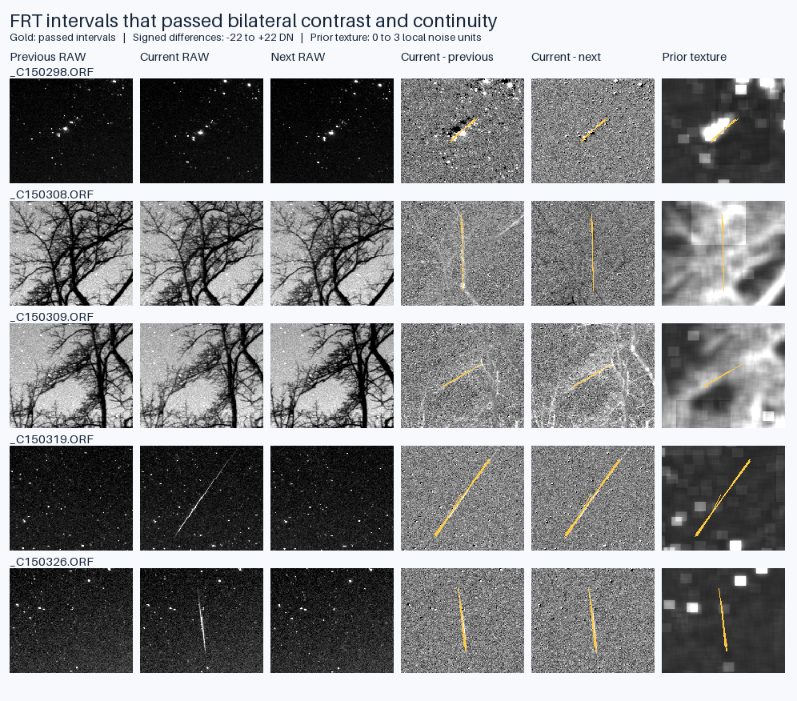

# 直前RAWの局所的な凹凸によるFRT線分検証

[前回のFRT検証](frt_line_verification_ja.md)では、系列を外した閾値選択で
ハフの既存3枚と2021GEMINIの2枚を回収した。残った偽陽性3枚で検証を通った区間を復元し、
その周囲の直前RAWの状態を使って候補を見直した。

## 検証を通った区間



前回の2021GEMINI除外回で、両側コントラスト、支持長、得点下限を通った全区間を金色で示す。
表示範囲は各画像で同じ145×145 px。右端は直前RAWの局所的な凹凸を0〜3雑音単位で表示した。

| 画像 | 通過した区間 | 区間長（px） | 直前RAWの局所凹凸 p90（雑音単位） | 確認した特徴 |
| --- | ---: | ---: | ---: | --- |
| `_C150298.ORF` | 5 | 36.5〜40.9 | 3.60〜5.49 | 明るい点像が並ぶ場所での差分。中央帯の正の信号の63〜78%が最も明るい1割の標本に集中 |
| `_C150308.ORF` | 5 | 37.7〜106.5 | 2.55〜3.01 | 樹木が写る範囲のほぼ縦の残差。現在と次の差分では支持が最長3.0 px |
| `_C150309.ORF` | 3 | 38.0〜56.9 | 2.40〜2.44 | 枝に沿った斜めの残差。現在と次の差分にも最長38.0 pxの支持が残る |
| `_C150319.ORF` | 20 | 34.6〜119.6 | 0.58〜0.98 | 滑らかな空に出た流星光跡 |
| `_C150326.ORF` | 9 | 42.5〜86.6 | 0.69〜1.07 | 滑らかな空に出た流星光跡 |

3枚とも元の支持長を満たす区間があり、特に `_C150308.ORF` の区間長は流星と重なった。
`_C150309.ORF` では次のRAWとの差分にも連続した残差が見えた。
この5枚で明瞭だった差は、通過区間の周囲に直前から存在する構造の強さだった。
[全区間の座標と測定値](../experiments/region_comparison/results/frt_foreground/surviving_intervals.json)

## 121ペアでの系列除外評価

正の差分ハフの採用3枚を保持し、残る118ペアに対する前回のFRT候補線分を使った。
入力ハッシュ、目視ラベル、ビニング後のROIは前回と照合した。
検証に使う画素は現在と直前のRAWから取得し、次のRAWは上の残差比較に用いた。

- 直前RAWから標準偏差4 pxのガウシアン平滑化画像を引き、絶対値を13×13 pxで平均した。
  区間上でこれを符号付き差分の局所雑音尺度で割り、90パーセンタイルを求めた。
  点像や枝がある区間を判定する上限としてこの値を使った。
- 両側コントラスト8段階、途切れ0または最大3標本、最小支持長6段階、直前の局所凹凸上限
  7段階を組み合わせた。672通りから、残り2系列で偽陽性0枚を条件に、
  出現ペアで注釈軸被覆50%以上の流星を最大化した。
- FRT得点下限は、既定の8で固定する方法、学習側の陰性得点の直上に置く方法、
  最低値を10にしたうえで同様に選ぶ方法を比較した。さらに、学習側だけで求めた
  陰性を除く下限と、回収した流星の軸一致を維持できる上限の間に余裕を取る方法を比較した。
  この場合は得点の比が大きい設定を優先し、両境界の幾何平均を下限とした。

| 方式 | 軸が一致した流星 | 偽陽性 |
| --- | ---: | ---: |
| 前回の両側コントラスト＋連続性＋FRT得点 | 5/6 | 3/115 |
| 直前RAWの局所凹凸を追加、FRT得点下限8で固定 | 3/6 | 1/115 |
| 同、FRT得点下限を学習側の陰性の直上に設定 | 5/6 | 1/115 |
| 同、FRT得点下限の最低値を10に設定 | **5/6** | **0/115** |
| 同、学習側の流星と陰性の間に得点の余裕を設定 | **5/6** | **0/115** |

FRT得点下限の最低値10と得点の余裕を使う方法の両方で、航空機サンプルの2枚と
2021GEMINIの3枚を維持した。2021GEMINIを外した回の `_C150319.ORF` と
`_C150326.ORF` の被覆は90.2%、70.4%だった。前回の偽陽性3枚は候補外になった。
得点の余裕を使う方法の学習後下限は航空機サンプルと2021GEMINIの除外回で10.954、
2024GEMINI後半の除外回で18.481だった。

余裕を取らず最低値8で選んだ場合、2024GEMINI後半の `_C140523.ORF` が新たに候補に入った。
このとき検証を通ったFRT最高得点は8.061だった。`_C140521.ORF` は系列除外の比較では
回収できなかった。参考として全ラベルを使った設定選択では6枚全部の軸が一致し、
偽陽性は0枚だった。局所凹凸の特徴はこの121ペアに含まれる画像の診断から設計した。
系列除外は閾値選択に適用した。
[各系列の設定、候補と軸被覆](../experiments/region_comparison/results/frt_foreground/background_verification.json)

[_C140521.ORF の途切れの診断と、系列除外で6枚を回収した追試](frt_c140521_gap_verification_ja.md)

## 再現

リポジトリのルートから実行する。`--raw-root` にはRAWの配置先を指定する。

```bash
run_dir=$(mktemp -d)
raw_root=../detect_meteors_assets/rawfiles
PYTHONPATH=. uv run --locked python experiments/region_comparison/benchmark_hough_frt_retry.py \
  "$run_dir/frt" --raw-root "$raw_root" --workers 3 --save-proposals
PYTHONPATH=. uv run --locked python experiments/region_comparison/benchmark_frt_foreground.py \
  "$run_dir/frt" "$run_dir/foreground" --raw-root "$raw_root" --workers 3
PYTHONPATH=. uv run --locked python experiments/region_comparison/review_frt_foreground.py \
  "$run_dir/frt" "$run_dir/foreground" --raw-root "$raw_root"
```
