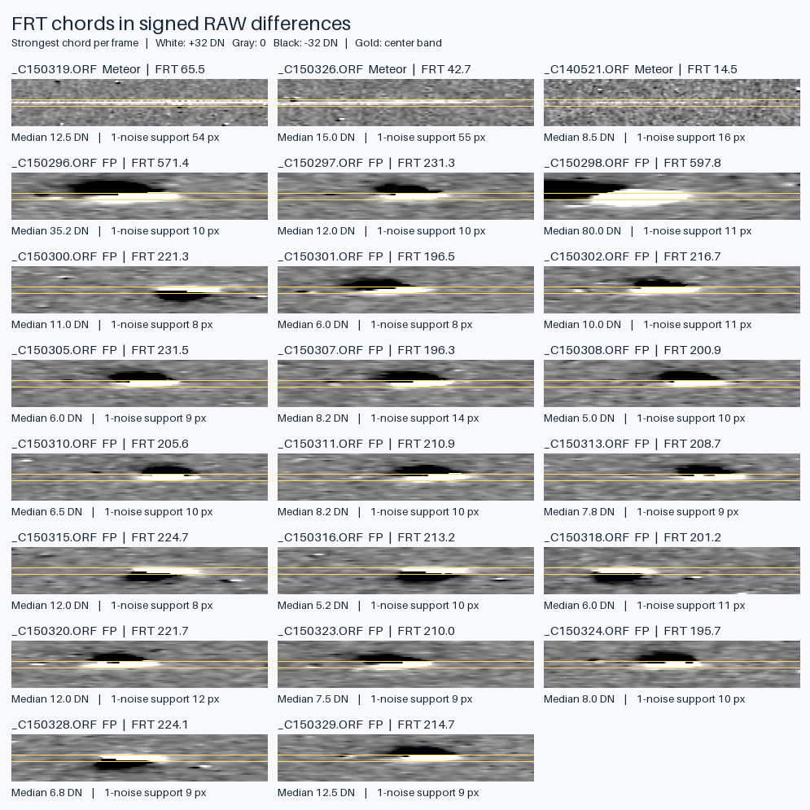

# FRT高得点線分の比較と局所的な光跡検証

[正の差分ハフからFRTに回した試験](hough_frt_retry_ja.md)で偽陽性になった20枚について、
当時の系列除外で使ったFRT得点下限189.852を満たす全280線分を測った。
取りこぼした流星3枚では、FRT既定の下限8で得られ、単独で注釈軸を50%以上覆う23線分を比較した。

## 高得点線分と流星光跡の差



各画像から比較条件を満たす最高得点の線分1本を表示した。符号付き差分を線分の向きに
揃え、横幅を統一した。金色の線の間が中央帯。全パネルの表示範囲は−32〜+32 DN。

| 比較対象 | FRT得点 | 線分長（px） | 局所コントラスト中央値（DN） | 局所雑音の1倍・3標本までの途切れを許した最長区間（px） |
| --- | ---: | ---: | ---: | ---: |
| 偽陽性20枚の各最高得点線分の中央値 | 214.0 | 17.0 | 8.1 | 9.7 |
| `_C150319.ORF` の代表線分 | 65.5 | 73.6 | 12.5 | 53.7 |
| `_C150326.ORF` の代表線分 | 42.7 | 63.2 | 15.0 | 55.3 |
| `_C140521.ORF` の代表線分 | 14.5 | 85.6 | 8.5 | 15.9 |

偽陽性20枚の最高得点線分はすべて長さ15.1〜19.2 pxで、中点がビニング後の
`x=735.5–753.0、y=1085.0–1104.5` に集中した。差分画像には同じ位置付近で明暗の塊が
隣接しており、明るい点像が隣接露光間でずれたときの残差と整合する。
全280線分には138.4 pxの長い線分もあったが、同じ連続支持の条件では最長16.9 pxだった。
偽陽性のコントラスト中央値は最高得点線分でも5〜80 DNに広がっており、明るさだけで
流星3枚と分けるのは難しい。2021年の流星2枚では低いFRT得点でも長い支持区間が残った。
`_C140521.ORF` は局所雑音の1倍では支持が分断され、0.6倍に下げると代表線分で31.9 pxになった。
[全比較線分の測定値](../experiments/region_comparison/results/frt_verification/line_comparison.json)

## 同じ121ペアでの検証

- 正の差分ハフで採用した3枚はそのまま残し、棄却された118ペアを試作FRTで再実行した。
  入力RAW、目視ラベル、ROI、検出結果を前回と照合した。FRTの元の得点下限8と各線分の
  正の画素率、幾何条件も使った。
- 各FRT線分に沿って約1 px間隔で、符号付き差分の中央帯（±1 px）の中央値から、
  側帯（±6〜8 px）の中央値を引いた。左右をまとめた側帯の中央値と、左右それぞれの
  中央値のうち明るい方を引く方式を比較した。後者は明るい側よりも中央帯が明るいことを
  要求し、片側の暗い残差だけでコントラストが高くなる影響を抑える。
- 局所コントラストをDNまたは64 pxタイルの局所雑音尺度で表し、線分方向に5標本で平均した。
  中央帯が正で、コントラストが下限以上の標本を支持とした。途切れは0または最大3標本とし、
  つなぐ場合は区間内の75%以上に支持があることを求めた。16、24、32、45、60、80 pxの
  支持長を試した。左右をまとめる方式と明るい側を使う方式で計288通りを比較した。
  判定と軸照合には、検証を通った区間の端点を使った。
- 評価対象の系列を外し、残る2系列で偽陽性0枚を条件に、注釈軸の50%以上を覆った流星数を
  最大化した。FRT得点下限を8に固定する条件と、検証済み線分だけで追加の得点下限を
  選ぶ条件を比較した。追加下限には、学習側の陰性に残った最高得点の直上を使った。
  評価系列の判定には選ばれた設定をそのまま適用した。

### 系列を除外して選んだ結果

| 方式 | 流星が写る候補画像 | 注釈軸が一致した流星 | 偽陽性 |
| --- | ---: | ---: | ---: |
| 正の差分ハフのみ | 3/6 | 3/6 | 0/115 |
| 前回のFRT得点下限だけ | 5/6 | 3/6 | 20/115 |
| 左右をまとめた局所コントラスト＋連続性 | 3/6 | 3/6 | 5/115 |
| 左右をまとめた局所コントラスト＋連続性＋FRT得点下限 | 5/6 | 5/6 | 6/115 |
| 両側に対する局所コントラスト＋連続性 | 3/6 | 3/6 | 0/115 |
| 両側に対する局所コントラスト＋連続性＋FRT得点下限 | 5/6 | 5/6 | 3/115 |

既存の3枚は全条件で維持した。FRT得点下限も選ぶと、2021GEMINIを除外した回で
`_C150319.ORF` と `_C150326.ORF` を軸付きで追加回収できた。左右をまとめた方式で
被覆は97.6%と100%、両側に対する方式で91.7%と98.6%だった。
両側方式の偽陽性3枚は `_C150298.ORF`、`_C150308.ORF`、`_C150309.ORF` だった。
評価系列を外した比較では `_C140521.ORF` の軸を追加回収できなかった。

全ラベルを使って条件を選んだ参考集計では、両側に対する局所コントラストを雑音尺度の
0.6倍、連続32 px、途切れなし、FRT下限8とすると、2021年の2枚を含む5枚が軸一致し、
偽陽性は0枚だった。評価対象を閾値選択から外した比較では、追加回収と偽陽性0枚の
両立は確認できなかった。[系列別の設定・候補・被覆率](../experiments/region_comparison/results/frt_verification/frt_verification.json)

## 再現

リポジトリのルートで実行し、`--raw-root` にRAWの配置先を指定する。

```bash
run_dir=$(mktemp -d)
raw_root=../detect_meteors_assets/rawfiles
PYTHONPATH=. uv run --locked python experiments/region_comparison/benchmark_hough_frt_retry.py \
  "$run_dir/frt" --raw-root "$raw_root" --workers 3 --save-proposals
PYTHONPATH=. uv run --locked python experiments/region_comparison/benchmark_frt_verification.py \
  "$run_dir/frt" "$run_dir/verification" --raw-root "$raw_root" --workers 3
PYTHONPATH=. uv run --locked python experiments/region_comparison/review_frt_verification.py \
  "$run_dir/frt" "$run_dir/verification" --raw-root "$raw_root"
```
