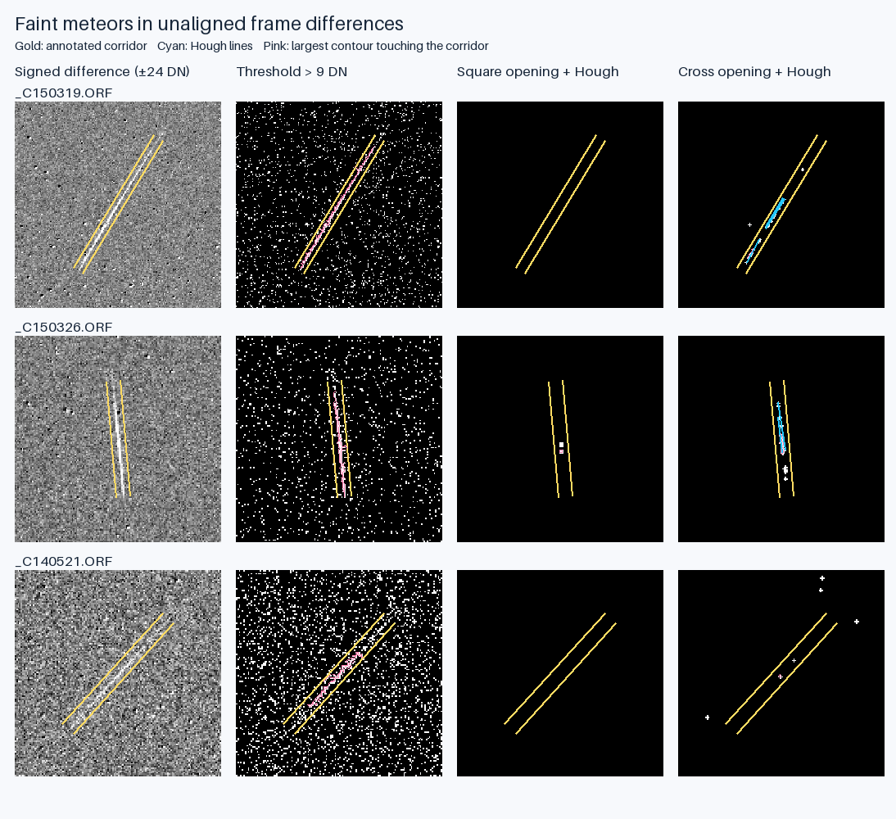

# 正の差分で取りこぼした3本の流星

位置合わせなしの正の差分で、固定設定が拾えなかった `_C150319.ORF`、
`_C150326.ORF`、`_C140521.ORF` を調べた。前回と同じ121ペアで、既存の検出を維持し、
偽陽性を0枚に保ったまま追加回収できるかを比較した。
[位置合わせと正の差分の比較](hough_registration_thresholds_ja.md)

## 差分からハフ線分まで

3枚とも `現在 − 直前` の差分に光跡があり、注釈軸上で差分が正の点は93%以上だった。
9 DNで二値化した直後は、3枚とも光跡に沿った細長い輪郭が許容帯にかかっていた。
既定の3×3正方形オープニングで2枚の光跡部分が消え、もう1枚では小さな断片が残った。



黄色は光跡の注釈軸の許容帯、桃色は許容帯にかかる最大輪郭、水色はハフ線分。
左列は同じ ±24 DN で表示した。右列は3×3十字形に差し替え、閾値を固定した診断用の結果。

| 流星画像 | 中央帯と側帯の中央値差 | 軸上で >9 DN の点 | 許容帯のマスク画素（二値化直後 → 正方形後） | 許容帯にかかる最大輪郭の面積（px²） | 正方形後のハフ線分（ROI全体 / 軸と一致） |
| --- | ---: | ---: | ---: | ---: | ---: |
| `_C150319.ORF` | 8 DN | 65.7% | 280 → 0 | 105.5 → なし | 0 / 0 |
| `_C150326.ORF` | 13.5 DN | 88.0% | 198 → 18 | 75.0 → 4.0 | 0 / 0 |
| `_C140521.ORF` | 8 DN | 77.2% | 268 → 0 | 48.0 → なし | 19 / 0 |

- `_C150319.ORF` は二値化直後の最大輪郭の縦横比が18.84だった。正方形オープニング後は許容帯に輪郭がなく、ROI全体も線分0本だった。
- `_C150326.ORF` は許容帯に18画素が残り、輪郭は小さな断片2個に分かれた。最大輪郭の縦横比は1.0で、ROI全体も線分0本だった。
- `_C140521.ORF` は光跡付近の画素が全て消えた。ROI全体では線スコア646.99 pxだったが、19本の線分による光跡被覆は0%。面積を満たした輪郭の最大縦横比も2.25で、既定の3.0を超えなかった。

十字形は固定閾値のまま2021年の2枚に線分を残した。注釈軸の被覆は39.0%、43.2%で、
照合条件の50%に届かなかった。`_C140521.ORF` は十字形で候補になったが、光跡被覆は0%だった。
[輪郭の座標と線分の実測 JSON](../experiments/region_comparison/results/hough_recovery/diagnosis.json)

## 121ペアでの閾値選択

- 既存の入力・注釈・16 px収縮済みの空の ROI を使った。流星6枚と陰性115枚を採点した。
  流星の回収は、出現ペアが候補になり、注釈軸の50%以上をハフ線分で覆うことを条件とした。
- 正方形と十字形の各3×3オープニングで、前回のグリッドに差分3・4 DN、最小面積0 px²、
  縦横比1.5、線スコア10 pxを加えた。ハフ投票閾値6・10、最小線分長10・15 px、
  最大ギャップ5・12 pxを独立に振り、計432,000通りを調べた。
- 1系列を評価用に外し、残り2系列だけで偽陽性0枚と固定設定の既存回収の維持を要求した。
  条件内で軸が一致する流星を最大化し、同数なら固定値に近い設定を選んだ。
  さらに固定設定の候補を残し、棄却されたペアだけを別設定で再検査する方式も試した。
- 探索範囲の設計には上の診断を使った。系列除外は各回の閾値選択に適用した。
  航空機サンプルと2024GEMINI後半は同じ撮影系列の別区間を含む。

### 評価系列を外した結果

| 方式 | 流星が写る候補画像 | 注釈軸が一致した流星 | 偽陽性 |
| --- | ---: | ---: | ---: |
| 固定設定 | 3/6 | 3/6 | 0/115 |
| 正方形で閾値を探索 | 2/6 | 2/6 | 0/115 |
| 正方形と十字形を含めて探索 | 2/6 | 2/6 | 2/115 |
| 固定設定で棄却したペアだけを再検査 | 4/6 | 3/6 | 13/115 |

3枚とも、評価系列を外した比較では追加の軸一致が得られなかった。
単一設定の探索では、航空機サンプルを外した回で既存の `_C140344.ORF` も候補から外れた。
再検査では既存の3枚を維持した。`_C140521.ORF` は候補に入ったが、
流星軸の被覆は0%で、同じ評価系列に偽陽性が13枚出た。
[系列ごとの設定と画像別の判定](../experiments/region_comparison/results/hough_recovery/recovery.json)

### 全ラベルを使った場合の回収と偽陽性

この集計には評価対象のラベルも使った。単一設定で既存の3枚を維持し、各流星の軸を
50%以上覆って候補にできた設定の中で、偽陽性の最小値を示す。

| 回収対象 | 正方形の偽陽性最小値 | 十字形の偽陽性最小値 |
| --- | ---: | ---: |
| `_C150319.ORF` | 3 | 1 |
| `_C150326.ORF` | 3 | 0 |
| `_C140521.ORF` | 条件を満たす設定なし | 1 |

全ラベルを使った単一設定では、十字形・差分8 DN・最小面積20 px²・最小縦横比4.0・
線スコア30 pxで、既存の3枚と `_C150326.ORF` を回収し、偽陽性は0枚だった。
ハフ投票閾値10、最小線分長15 px、最大ギャップ5 pxを使い、追加の流星の軸被覆は67.9%だった。

全ラベルで再検査の設定を選ぶと、十字形・差分8 DN・最小面積3 px²・最小縦横比5.0・
線スコア30 pxで、`_C150319.ORF` の70.5%と `_C150326.ORF` の67.9%を覆った。
ハフ投票閾値10、最小線分長15 px、最大ギャップ12 pxを使い、既存の3枚を含む5枚を
偽陽性0枚で回収した。2枚が含まれる2021GEMINIを閾値選択から外した回では、
再検査用にも固定設定が選ばれ、どちらも取りこぼした。

[試作FRTで棄却ペアを再検査した結果](hough_frt_retry_ja.md)

## 再現

リポジトリのルートから実行し、`--raw-root` は RAW の配置先を指定する。

```bash
run_dir=$(mktemp -d)
PYTHONPATH=. uv run --locked python experiments/region_comparison/review_hough_recovery.py \
  "$run_dir" --raw-root ../detect_meteors_assets/rawfiles
PYTHONPATH=. uv run --locked python experiments/region_comparison/benchmark_hough_recovery.py \
  "$run_dir" --raw-root ../detect_meteors_assets/rawfiles
```
