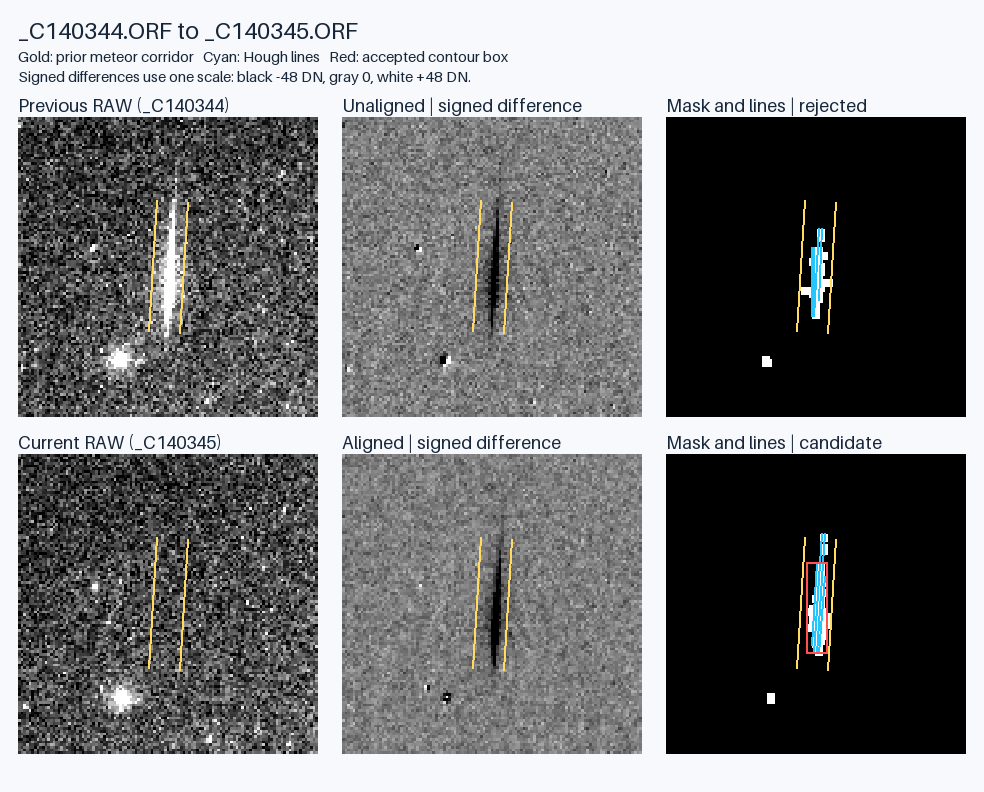

# 恒星位置合わせ後のハフ検出と閾値の比較

## なぜ `_C140345.ORF` が候補に増えたか

直前の `_C140344.ORF` に写った流星が次の露光で消え、その光跡が
`現在 − 直前` の符号付き差分に暗い線として残った。ハフ検出は絶対差分を使うため、
この負の残差も線分になる。位置合わせ後、光跡付近の輪郭が細長くなり、縦横比の条件を通過した。



図はビニング後の同一範囲を拡大したもの。符号付き差分の表示範囲は両条件とも ±48 DN。
黄色は直前画像で注釈した流星軸の許容帯、水色はハフ線分、赤は候補条件を満たした輪郭の外接矩形を示す。
[サンプル設定](../config_examples/star_registration_sample.yaml)で ROI と閾値を再現した。
直前画像から現在画像への変換は、原点での並進が `(+0.822, +0.437) px`、画像座標の回転成分は
`−0.0028°` だった。499対応点のうち487点を変換の推定に採用した。

| 測定値 | 位置合わせなし | 回転＋平行移動 |
| --- | ---: | ---: |
| ROI 全体の二値マスク画素数（オープニング後） | 3,093 | 1,060 |
| 流星付近の代表輪郭の面積（px²） | 106 | 150 |
| 同じ輪郭の長辺 / 短辺（px） | 25.90 / 10.37 | 34 / 8 |
| 面積条件を満たす輪郭の最大縦横比（候補条件は > 3.0） | 2.50 | 4.25 |
| ROI 全体のハフ線分数 / 合計長（候補条件は ≥ 30 px） | 5 / 126.38 px | 4 / 150.33 px |
| 直前の注釈軸に沿う最長線分 | 33.06 px | 45.10 px |
| 直前の注釈軸の被覆率 | 67.6% | 87.7% |
| 光跡の中央帯と側帯の中央値の差（符号付き） | −36 DN | −21 DN |

候補判定に使う面積と線スコアは両条件で閾値を超え、縦横比で判定が分かれた。
位置合わせ後の4本はすべて注釈軸に重なった。最長線分の一つは
`(1568, 243) → (1571, 198)` で、この線分を含め4本とも線上の採取点がすべて負だった。
同じハフ処理に正の差分だけを渡すと0本で、負の差分だけを渡すと候補判定が再現した。
位置合わせ後は空全体のマスク画素が減り、局所の光跡は長く細い形で残った。
[線分座標と極性別の測定値](../experiments/region_comparison/results/hough_registration/c140345.json)

## 121ペアでの閾値探索

- [位置合わせ試作の評価](star_registration_evaluation_ja.md)と同じ航空機サンプル11ペア、
  2021GEMINI 35ペア、2024GEMINI後半75ペアを使った。入力のハッシュを照合し、
  目視ラベルの流星6枚と陰性115枚を採点した。直前の流星の消失だけで候補になった画像は偽陽性に数えた。
- 組み込みの `star_registration` が121ペアすべてで変換を適用した。
  位置合わせの有無には共通の検出 ROI を使った。試作評価と同じ16 px収縮済み ROI の全画素が
  変換後も有効だった。固定値での位置合わせありの偽陽性は今回9枚、試作評価では11枚だった。
  今回の変換は全対応点を入力した組み込みフックの推定に基づく。
- `diff_threshold`、`min_area`、`min_aspect_ratio`、`min_line_score` を各方式で同じ
  18,032通りから探索した。画素の差分閾値を変えるたびにハフ線分と輪郭を再計測した。
  ハフ投票閾値10、最小線分長15 px、最大ギャップ5 pxは固定した。
- 位置合わせなしの固定値で拾えた流星画像をすべて候補に残し、出現ペアで成立していた
  50%以上の軸被覆も維持することを条件とした。事象ごとに出現ペアまたは次ペアで成立した軸一致も維持した。
  条件内で偽陽性を最小化し、同数なら出現ペアの軸一致数、真陽性数、事象一致数を順に優先した。
  なお同数のときは固定値からのグリッド上の移動量が小さい組み合わせを選んだ。

### 全121ペアで閾値を選んだ場合

設定欄は差分閾値（DN） / 最小面積（px²） / 最小縦横比 / 最小線スコア（px）の順。

| 位置合わせ | 閾値の選び方 | 設定 | 流星画像 | 出現ペアの軸一致 | 偽陽性 |
| --- | --- | --- | ---: | ---: | ---: |
| なし | 固定値 | 9 / 3 / 3.0 / 30 | 3/6 | 3/6 | 6/115 |
| あり | 固定値 | 9 / 3 / 3.0 / 30 | 3/6 | 3/6 | 9/115 |
| なし | 差分閾値だけ探索 | 13 / 3 / 3.0 / 30 | 3/6 | 3/6 | 4/115 |
| あり | 差分閾値だけ探索 | 17 / 3 / 3.0 / 30 | 3/6 | 3/6 | 4/115 |
| なし | 4項目を探索 | 9 / 3 / 4.0 / 30 | 3/6 | 3/6 | 2/115 |
| あり | 4項目を探索 | 7 / 80 / 4.0 / 30 | 3/6 | 3/6 | 2/115 |

4項目を調整すると、両方式とも `_C140338.ORF`、`_C140344.ORF`、`_C150303.ORF` の
出現を軸付きで回収した。残った偽陽性は、両方式とも `_C140339.ORF` と
`_C150304.ORF` だった。元の ROI を使うサンプルの通常 CLI でも位置合わせありの調整値を
試し、`_C140345.ORF` が候補から外れ、2枚の流星が残ることを確認した。

### 1系列ずつ閾値選択から外した場合

各行の設定は、対象系列を採点に使う前に、ほかの2系列だけで選んだ。
航空機サンプルと2024GEMINI後半は同じ撮影系列の別区間を含むため、この比較で評価できる
汎化には限りがある。

| 評価対象 | 位置合わせなしの設定 | 流星画像 / 偽陽性 | 位置合わせありの設定 | 流星画像 / 偽陽性 |
| --- | --- | ---: | --- | ---: |
| 航空機サンプル | 9 / 3 / 4.0 / 30 | 2/2、1/9 | 9 / 3 / 5.0 / 30 | 1/2、1/9 |
| 2021GEMINI | 8 / 3 / 3.5 / 30 | 1/3、2/32 | 9 / 3 / 3.5 / 180 | 1/3、3/32 |
| 2024GEMINI後半 | 9 / 3 / 4.0 / 30 | 0/1、0/74 | 7 / 80 / 4.0 / 30 | 0/1、0/74 |
| 合計 | | 3/6、3/115 | | 2/6、4/115 |

全121ペアで選んだ閾値では、位置合わせ付きでも既存の検出3枚を維持して偽陽性を9枚から
2枚に減らせた。位置合わせなしでも同じ2枚まで減った。系列を外した比較では、
位置合わせありで `_C140344.ORF` を取りこぼした。今回のデータからは、共通の閾値で
位置合わせにより流星の回収率と偽陽性の両方が改善するとは判断できない。

## 再現

実 RAW のチェックサムと採点結果は[実測 JSON](../experiments/region_comparison/results/hough_registration/thresholds.json)
に記録した。リポジトリのルートで実行する。ローカルに配置した RAW の場所に合わせて
`--raw-root` を指定する。

```bash
run_dir=$(mktemp -d)
PYTHONPATH=. uv run --locked python experiments/region_comparison/review_hough_registration.py \
  "$run_dir" --raw-root ../detect_meteors_assets/rawfiles
PYTHONPATH=. uv run --locked python experiments/region_comparison/benchmark_hough_registration.py \
  "$run_dir" --raw-root ../detect_meteors_assets/rawfiles
```
