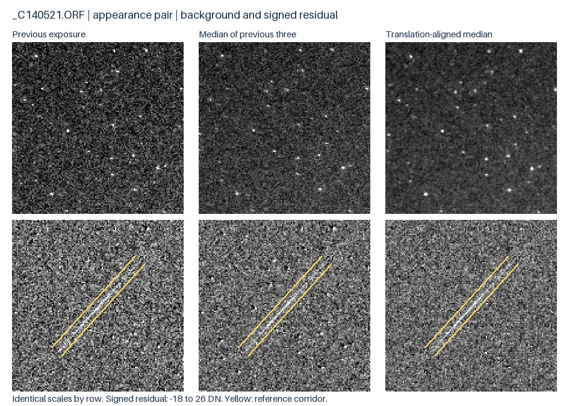
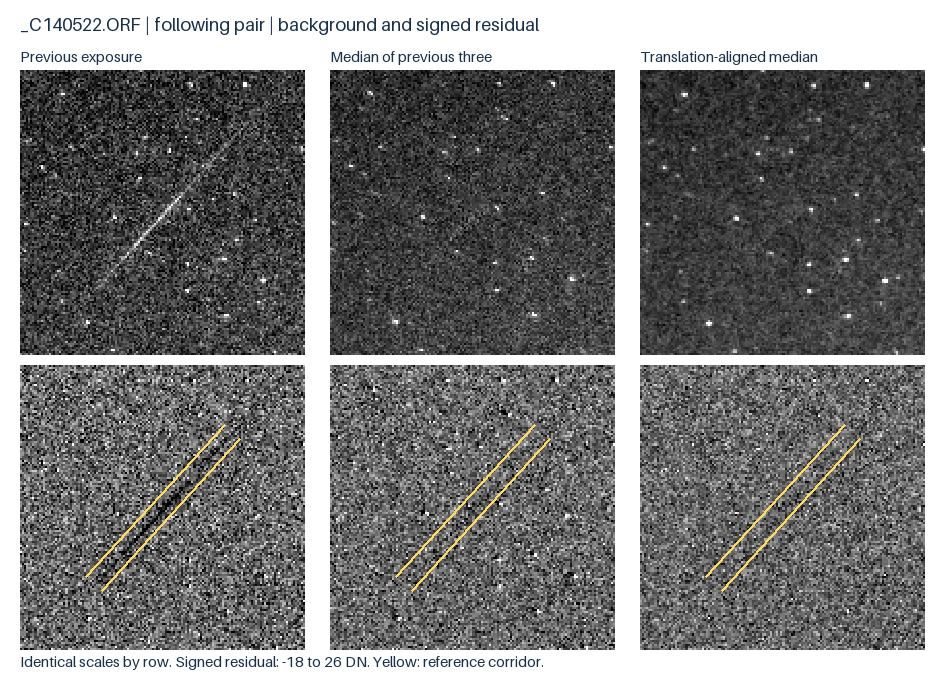
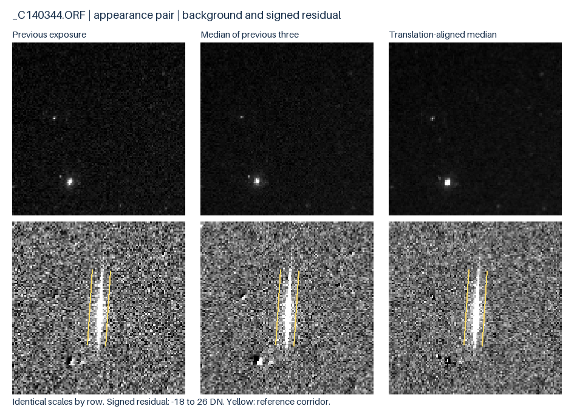
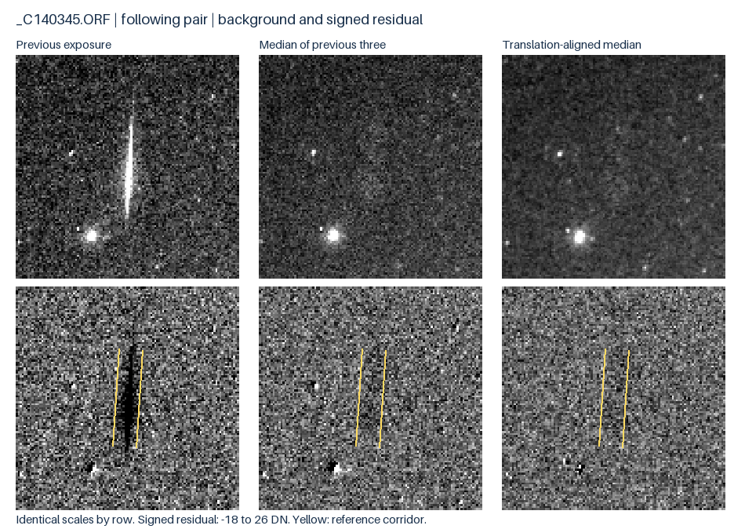

# 平行移動で位置合わせした時間方向の中央値背景

## 目的と比較条件

空の恒星を使い、直前3枚を現在露光の座標に合わせて中央値を取る背景を試作した。既存の[隣接ペアでの恒星位置合わせ試験](star_registration_evaluation_ja.md)では、恒星近傍の残差が減ったものの、固定閾値での偽陽性は減らなかった。今回は平行移動付き中央値を、直前露光と位置合わせなしの3枚中央値に対して、同じ偽陽性率で比較した。

| 背景 | 直前3枚がそろった場合 |
| --- | --- |
| 隣接差分 | 直前1枚をそのまま使用 |
| 中央値 | 直前3枚の同じセンサ画素の中央値 |
| 位置合わせ付き中央値 | 空のROI内の恒星を対応付け、直前3枚をそれぞれ現在座標まで直接平行移動。各画像を双一次補間で1回だけ再標本化し、画素ごとに中央値を取る |

同梱11・2021GEMINI 35・2024GEMINI後半75の計121ペアを用いた。ビニングと空のROIは位置合わせ試験と共通。各系列の先頭2ペアは、直前3枚がそろわないため3条件とも隣接差分とした。121ペア全体を集計し、3枚がそろった9・33・73ペアの結果も示す。恒星の対応から得た変換をそのまま現在座標に適用し、隣接の変換を打ち継がない。1枚でも変換を信頼できない場合は、その窓全体を位置合わせなしの中央値に戻す。

## 検出条件と偽陽性率

検出器は全121ペアで同じ全画面FRTプラグインの既定設定とした。探索するROIは条件間で共通。FRTが符号、最小長、ROI、正規化得点の既定条件で採用した線分から、フレームの最大得点を求めた。追加閾値を超える線分が1本でもあれば露光を候補とし、光跡被覆も同じ追加閾値を超える線分だけから求めた。最大得点を出した別の線分による候補化と、実際の流星光跡の回収を区別する。

元の露光に流星の記載がない画像を陰性とした。後続の消失像による候補も偽陽性に含む。幾何学的な出現時一致は、候補判定と参照軸被覆50%以上の両方を要求した。補足の事象一致は出現ペアと直後のペアを同一事象として数えた。短い光跡の比較対象は、注釈長100 px未満の `_C140344.ORF`、`_C150326.ORF`、`_C140521.ORF` の3本。淡い光跡の比較には、既報で淡いと確認した `_C150319.ORF`、`_C150326.ORF`、`_C140521.ORF` の3本を用いた。

閾値は次の2種類の集計を行った。名目予算は5%、10%、20%、50%。陰性数を掛けて切り捨てた件数を上限とし、閾値と同点の得点は除外した。

- **評価系列内での負荷をそろえた比較**。各系列の陰性得点から、3条件の偽陽性枚数を同じ予算にそろえた。3枚がそろった部分だけでの負荷も別にそろえた。同じ評価系列の陰性ラベルを閾値選びに使うため、既知のデータ上での比較である。
- **別区間で閾値を固定した比較**。評価対象とRAWを共有しない2024GEMINIの `_C140200.ORF`〜`_C140240.ORF` で校正した。現在露光と直前3枚がすべて陰性の窓だけを使った。固定閾値をそのまま11・35・75ペアに適用して、実際の偽陽性率と回収を記録した。

## 実測結果

### 評価系列内で偽陽性率をそろえた比較

全121ペアの名目10%の結果。陰性枚数を分母として実際の偽陽性数を示す。

| 系列 | 背景 | 追加の得点下限 | 偽陽性 / 陰性 | 候補 | 陽性露光 | 出現時の光跡一致 | 事象一致 |
| --- | --- | --- | --- | --- | --- | --- | --- |
| 同梱11 | 隣接差分 | 188.28 | 0/9 | 1 | 1/2 | 1/2 | 1/2 |
| 同梱11 | 中央値 | 356.66 | 0/9 | 1 | 1/2 | 1/2 | 1/2 |
| 同梱11 | 位置合わせ付き中央値 | 171.21 | 0/9 | 1 | 1/2 | 1/2 | 1/2 |
| 2021GEMINI 35 | 隣接差分 | 231.35 | 3/32 | 4 | 1/3 | 1/3 | 1/3 |
| 2021GEMINI 35 | 中央値 | 439.24 | 3/32 | 4 | 1/3 | 1/3 | 1/3 |
| 2021GEMINI 35 | 位置合わせ付き中央値 | 231.35 | 3/32 | 4 | 1/3 | 1/3 | 1/3 |
| 2024GEMINI後半75 | 隣接差分 | 175.36 | 7/74 | 7 | 0/1 | 0/1 | 0/1 |
| 2024GEMINI後半75 | 中央値 | 335.42 | 7/74 | 7 | 0/1 | 0/1 | 0/1 |
| 2024GEMINI後半75 | 位置合わせ付き中央値 | 64.05 | 7/74 | 8 | 1/1 | 0/1 | 0/1 |

負荷を変えたときの出現時の光跡一致。

| 名目予算 | 背景 | 偽陽性（同梱 / 2021 / 2024） | 出現時の光跡一致 | 短い光跡 | 淡い光跡 |
| --- | --- | --- | --- | --- | --- |
| 5% | 隣接差分 | 0 / 1 / 3 | 2/6 | 0/3 | 0/3 |
| 5% | 中央値 | 0 / 1 / 3 | 2/6 | 0/3 | 0/3 |
| 5% | 位置合わせ付き中央値 | 0 / 1 / 3 | 2/6 | 0/3 | 0/3 |
| 10% | 隣接差分 | 0 / 3 / 7 | 2/6 | 0/3 | 0/3 |
| 10% | 中央値 | 0 / 3 / 7 | 2/6 | 0/3 | 0/3 |
| 10% | 位置合わせ付き中央値 | 0 / 3 / 7 | 2/6 | 0/3 | 0/3 |
| 20% | 隣接差分 | 1 / 6 / 14 | 2/6 | 0/3 | 0/3 |
| 20% | 中央値 | 1 / 6 / 14 | 2/6 | 0/3 | 0/3 |
| 20% | 位置合わせ付き中央値 | 1 / 6 / 14 | 2/6 | 0/3 | 0/3 |
| 50% | 隣接差分 | 4 / 16 / 37 | 2/6 | 0/3 | 0/3 |
| 50% | 中央値 | 4 / 16 / 37 | 2/6 | 0/3 | 0/3 |
| 50% | 位置合わせ付き中央値 | 4 / 16 / 37 | 3/6 | 1/3 | 0/3 |

各方式が3枚の履歴を持てる115ペアで、名目10%の予算を改めてそろえた。

| 系列 | 背景 | 追加の得点下限 | 偽陽性 / 陰性 | 候補 | 陽性露光 | 出現時の光跡一致 | 事象一致 |
| --- | --- | --- | --- | --- | --- | --- | --- |
| 同梱9 | 隣接差分 | 188.28 | 0/7 | 1 | 1/2 | 1/2 | 1/2 |
| 同梱9 | 中央値 | 356.66 | 0/7 | 1 | 1/2 | 1/2 | 1/2 |
| 同梱9 | 位置合わせ付き中央値 | 65.22 | 0/7 | 2 | 2/2 | 2/2 | 2/2 |
| 2021GEMINI 33 | 隣接差分 | 224.14 | 3/30 | 4 | 1/3 | 1/3 | 1/3 |
| 2021GEMINI 33 | 中央値 | 432.99 | 3/30 | 4 | 1/3 | 1/3 | 1/3 |
| 2021GEMINI 33 | 位置合わせ付き中央値 | 141.80 | 3/30 | 4 | 1/3 | 1/3 | 1/3 |
| 2024GEMINI後半73 | 隣接差分 | 175.36 | 7/72 | 7 | 0/1 | 0/1 | 0/1 |
| 2024GEMINI後半73 | 中央値 | 335.42 | 7/72 | 7 | 0/1 | 0/1 | 0/1 |
| 2024GEMINI後半73 | 位置合わせ付き中央値 | 63.03 | 7/72 | 8 | 1/1 | 0/1 | 0/1 |

### 別区間の陰性データで固定した閾値

名目10%で校正した閾値を、全評価系列にそのまま適用した。校正側の偽陽性は隣接差分 3/34、中央値 3/34、位置合わせ付き中央値 3/34だった。

| 系列 | 背景 | 追加の得点下限 | 偽陽性 / 陰性 | 候補 | 陽性露光 | 出現時の光跡一致 | 事象一致 |
| --- | --- | --- | --- | --- | --- | --- | --- |
| 同梱11 | 隣接差分 | 177.84 | 2/9 | 3 | 1/2 | 1/2 | 1/2 |
| 同梱11 | 中央値 | 349.70 | 1/9 | 2 | 1/2 | 1/2 | 1/2 |
| 同梱11 | 位置合わせ付き中央値 | 68.46 | 2/9 | 4 | 2/2 | 2/2 | 2/2 |
| 2021GEMINI 35 | 隣接差分 | 177.84 | 25/32 | 28 | 3/3 | 1/3 | 1/3 |
| 2021GEMINI 35 | 中央値 | 349.70 | 31/32 | 34 | 3/3 | 1/3 | 1/3 |
| 2021GEMINI 35 | 位置合わせ付き中央値 | 68.46 | 32/32 | 34 | 2/3 | 2/3 | 2/3 |
| 2024GEMINI後半75 | 隣接差分 | 177.84 | 5/74 | 5 | 0/1 | 0/1 | 0/1 |
| 2024GEMINI後半75 | 中央値 | 349.70 | 2/74 | 2 | 0/1 | 0/1 | 0/1 |
| 2024GEMINI後半75 | 位置合わせ付き中央値 | 68.46 | 5/74 | 6 | 1/1 | 0/1 | 0/1 |

### FRTの既定閾値と淡い・短い光跡

順位付け用の追加閾値を取り除いた場合。FRTの元の検証条件は共通。

| 系列 | 背景 | 追加の得点下限 | 偽陽性 / 陰性 | 候補 | 陽性露光 | 出現時の光跡一致 | 事象一致 |
| --- | --- | --- | --- | --- | --- | --- | --- |
| 同梱11 | 隣接差分 | 既定 | 9/9 | 11 | 2/2 | 2/2 | 2/2 |
| 同梱11 | 中央値 | 既定 | 9/9 | 11 | 2/2 | 2/2 | 2/2 |
| 同梱11 | 位置合わせ付き中央値 | 既定 | 9/9 | 11 | 2/2 | 2/2 | 2/2 |
| 2021GEMINI 35 | 隣接差分 | 既定 | 32/32 | 35 | 3/3 | 3/3 | 3/3 |
| 2021GEMINI 35 | 中央値 | 既定 | 32/32 | 35 | 3/3 | 3/3 | 3/3 |
| 2021GEMINI 35 | 位置合わせ付き中央値 | 既定 | 32/32 | 35 | 3/3 | 3/3 | 3/3 |
| 2024GEMINI後半75 | 隣接差分 | 既定 | 74/74 | 75 | 1/1 | 1/1 | 1/1 |
| 2024GEMINI後半75 | 中央値 | 既定 | 74/74 | 75 | 1/1 | 1/1 | 1/1 |
| 2024GEMINI後半75 | 位置合わせ付き中央値 | 既定 | 74/74 | 75 | 1/1 | 1/1 | 1/1 |

値の並びは「隣接差分 / 中央値 / 位置合わせ付き中央値」。コントラストは元の符号付き差分における中央帯と側帯の中央値差。最少の偽陽性は、出現ペアで参照軸の被覆が初めて50%に達する閾値で、その系列の陰性も再集計した記述値である。

| 出現露光 | 符号付きコントラスト（DN） | FRT既定での被覆率 | 単独で50%以上覆う線分の最大得点 | 回収に必要だった最少の偽陽性（枚数/陰性数） |
| --- | --- | --- | --- | --- |
| `_C140338.ORF` | 99.0 / 97.0 / 96.0 | 100.0% / 100.0% / 100.0% | 476.20 / 548.68 / 602.79 | 0/9, 0/9, 0/9 |
| `_C140344.ORF` | 34.5 / 32.0 / 33.5 | 100.0% / 100.0% / 100.0% | 82.72 / 95.26 / 105.74 | 9/9, 9/9, 2/9 |
| `_C150303.ORF` | 78.0 / 77.0 / 78.0 | 100.0% / 100.0% / 100.0% | 3090.38 / 3382.06 / 3056.11 | 0/32, 0/32, 0/32 |
| `_C150319.ORF` | 8.0 / 9.0 / 8.0 | 100.0% / 100.0% / 100.0% | 65.54 / 73.38 / 84.69 | 32/32, 32/32, 27/32 |
| `_C150326.ORF` | 13.5 / 13.0 / 13.0 | 100.0% / 100.0% / 100.0% | 42.69 / 50.11 / 54.93 | 32/32, 32/32, 32/32 |
| `_C140521.ORF` | 8.0 / 7.0 / 8.0 | 100.0% / 100.0% / 100.0% | 14.55 / 16.17 / 17.66 | 74/74, 74/74, 74/74 |

### 処理時間

固定された3つの方式をペアごとに順番をずらして1回ずつ実行した。背景時間には、位置合わせ付きの場合の特徴点抽出、対応・変換推定、補間、中央値を含む。最初の露光の特徴点抽出は別計時。過去の特徴点は再利用した。RAWの読み込み、画像の書き出し、集計は表の時間に含めない。

履歴がそろった115ペアのうち、115ペアで位置合わせを適用した。

| 系列 | 背景 | 背景（秒） | FRT（秒） | 合計（秒） | 背景の中央値（ms/ペア、履歴あり） | 空の絶対差分 p99（DN、履歴あり） |
| --- | --- | --- | --- | --- | --- | --- |
| 同梱11 | 隣接差分 | 0.00 | 15.87 | 15.87 | 0.0 | 26 |
| 同梱11 | 中央値 | 0.03 | 16.50 | 16.52 | 3.0 | 23 |
| 同梱11 | 位置合わせ付き中央値 | 0.80 | 15.42 | 16.22 | 74.7 | 19 |
| 2021GEMINI 35 | 隣接差分 | 0.00 | 52.17 | 52.17 | 0.0 | 16 |
| 2021GEMINI 35 | 中央値 | 0.10 | 55.83 | 55.92 | 3.1 | 16 |
| 2021GEMINI 35 | 位置合わせ付き中央値 | 2.49 | 52.62 | 55.10 | 70.8 | 13 |
| 2024GEMINI後半75 | 隣接差分 | 0.00 | 104.44 | 104.44 | 0.0 | 25 |
| 2024GEMINI後半75 | 中央値 | 0.21 | 110.52 | 110.72 | 2.9 | 22 |
| 2024GEMINI後半75 | 位置合わせ付き中央値 | 5.56 | 100.48 | 106.04 | 74.0 | 19 |

## 実RAWの処理画像

上段は背景に用いた画像、下段はそれを現在露光から引いた符号付き差分。各行の表示範囲は3列で共通である。黄色は参照軸の許容帯。出現と消失をそれぞれ確認できる。









## 採用判断

評価系列内で偽陽性率をそろえた全121ペアの名目10%では、全方式が6本中2本、短い光跡と淡い光跡はそれぞれ0/3だった。位置合わせ付き中央値は2024年後半の唯一の陽性露光 `_C140521.ORF` を候補に残し、偽陽性数は他方式と同じ7枚だった。ただし光跡被覆は0%。この露光で光跡を50%以上覆う線分の得点は17.66まで上がったが、同じ確認負荷での下限64.05に届かなかった。FRT既定値で得た100%の被覆は、順位付けの閾値を上げると維持できなかった。

同梱の短い `_C140344.ORF` は、試料内で回収に必要な偽陽性枚数が隣接差分9枚、中央値9枚、位置合わせ付き中央値2枚だった。履歴がそろった9ペアだけを比べた場合、位置合わせ付き中央値は偽陽性なしでこの短い光跡を回収した。全11ペアでは位置合わせできない起動時の2ペアも候補順位に入り、同じ名目10%の予算では外れた。偽陽性を4枚許す条件では、全11ペアでも位置合わせ付き中央値だけが短い光跡を回収した。

別区間で3/34にそろえた閾値を2021GEMINIに適用すると、実際の偽陽性は方式ごとに25・31・32/32に増えた。位置合わせ付き中央値で淡い `_C150319.ORF` は97%を覆ったが、確認負荷がそろった結果ではない。今回の固定閾値を異なる系列の共通運用点として使う根拠は得られなかった。

実RAW画像では、中央値を使う2方式とも、次ペアの負の消失像を抑えた。位置合わせ付き中央値は空の絶対差分の99パーセンタイルを後半系列で25 DNから19 DNに下げ、背景の計算に1ペアあたり中央値74.0 msを要した。隣接差分、中央値、位置合わせ付き中央値の全121ペアの検出器と背景処理を合計した経過時間は、それぞれ172.47秒、183.17秒、177.37秒だった。少ない確認枚数で淡い光跡を拾うには、背景処理の改善に加えて、背景の高得点線分と流星の光跡を識別する順位付けが必要になる。

この評価の実流星は6本である。独立した撮影夜に設定を持ち出した場合の回収率や偽陽性率には、ここで調べた区間以外の検証が必要になる。背景の補間で雑音と点像分布も変わるため、空の残差の減少と幾何学的な光跡回収は別に評価した。

## 再現方法

[ペア別の得点、変換、被覆、時間と閾値別の評価](../experiments/region_comparison/results/registered_median/summary.json)に全実測を記録した。リポジトリのルートから実行する。RAWのSHA-256とラベルREADMEのハッシュを報告に収録している。

```bash
uv sync --locked
run_dir=$(mktemp -d)
uv build --no-sources --wheel --out-dir "$run_dir/dist" experiments/region_comparison
uv pip install --python .venv/bin/python --no-deps \
  --target "$run_dir/plugins" "$run_dir"/dist/*.whl
PYTHONPATH="$run_dir/plugins" .venv/bin/python \
  experiments/region_comparison/benchmark_registered_median.py "$run_dir/results"
PYTHONPATH=.:experiments/region_comparison .venv/bin/python \
  -m unittest discover -s experiments/region_comparison
```
