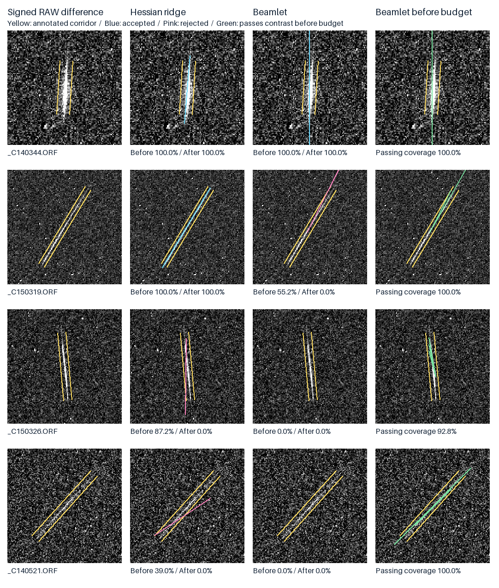

# ヘッセ行列によるリッジ検出と Beamlet 変換の試作評価

2026年11月21日 · Detect Meteors `feature/2_0_1`

## 評価の目的

RAW フレーム間の符号付き差分から光跡を抽出する2方式を試作した。ヘッセ行列によるリッジ検出は画素値の尾根の中心を求める。Beamlet 方式は長さ・向きの異なる有限線分に沿って応答を積算する。どちらも従来の検出プラグインと同じ経路で実行し、候補判定と参照光跡の被覆を別々に評価した。

## 試作の構成

| 段階 | `ridge` | `beamlet` |
| --- | --- | --- |
| 入力 | 現在フレームから直前フレームを引いた符号付き差分 | 同じ符号付き差分に標準偏差1・3 pxの DoG を適用し、ROI 外の応答を0にする |
| 探索 | 標準偏差1.0・1.6 pxのガウス微分。横断方向の負の曲率からサブピクセルの尾根点を求める | 32・64・128 px角のタイルを半幅ずらして配置。周上の約8等分点を結ぶ有限線分を評価する |
| 線分候補 | 尾根点の8近傍連結成分に直線を当てはめ、当てはめ軸方向の投影範囲を線分とする | タイルごとに得点上位2本を残し、256 px角の区画ごと・尺度ごとに6本までを計測に回す。画像全体の計測上限は1,536本 |
| 採用 | 長さ15 px以上、線分上のサンプル点がROI内、符号付き差分で局所コントラスト3 DN以上 | 同左 |

リッジ方式では、各尺度でガウス平滑化画像の二階微分をヘッセ行列にまとめる。小さい方の固有値が負で、その絶対値が接線方向の曲率より十分大きい点を求める。負の曲率に尺度の二乗を掛けた応答は1.5以上とした。法線方向の一次微分と二次微分から、画素値が極大となる位置を二次近似し、各座標の移動が0.55 px以内の場合に尾根点とする。同じ画素で複数の尺度が条件を満たした場合は応答最大の点を使う。成分は少なくとも8点を必要とし、投影長が横幅の2倍未満の成分は線分候補から除いた。これはSteger法に倣った中心線検出の試作である。原論文にある非対称プロファイルの補正や幅の推定は実装していない。[Stegerの原著](https://mv.in.tum.de/_media/members/steger/publications/1998/diss-1998-steger.pdf)

Beamlet 方式は、二進尺度の区画の周上から取った点対を線分の辞書とする。各線分を主軸方向に1 px刻みで標本化し、DoG応答の和を標本数の平方根と局所雑音尺度で割った値を得点にする。局所雑音尺度は、同じタイルの4 px間隔の標本から求めた中央値絶対偏差の1.4826倍と1 DNの大きい方である。タイル内の上位線分には得点8以上を課した。DoG により画素間の雑音は相関し、多数の線分を探索するため、この値を正規分布の有意度に読み替えることはできない。半幅ずらしたタイルと境界上のサンプリング点は、タイル境界で短い光跡が分断される影響と計算量を考慮した試作上の選択である。[Donoho・Huoの原著](https://statistics.stanford.edu/technical-reports/beamlets-and-multiscale-image-analysis)

両方式の局所コントラストは、前処理前の符号付き差分で、軸を含む中央3 px帯の中央値から、軸の両側6〜8 px帯をまとめた中央値を引いて求める。試作の採用条件は弱い光跡の診断を目的に3 DNとした。同じ計測結果を使い、6・9・15・20 DNに引き上げた場合も集計した。符号付き差分の使用により、出現と消失の信号は逆符号になる。候補フレームには、同じフレーム内の別の正の残差も寄与し得る。

## 実験条件

| 系列 | RAW範囲 | 隣接ペア数 | 参照光跡数 |
| --- | --- | ---: | ---: |
| 同梱 | `2024GEMINI_AIRCRAFT/_C140335.ORF`〜`_C140346.ORF` | 11 | 2 |
| 2021GEMINI | `2021GEMINI/_C150295.ORF`〜`_C150330.ORF` | 35 | 3 |
| 2024GEMINI後半 | `2024GEMINI/_C140452.ORF`〜`_C140527.ORF` | 75 | 1 |

基準の確率的ハフ変換、DoG＋LSD、領域方式の最終設定も同じ実験で再実行した。領域方式は3指標で最大64領域を再評価し、再推定後のコントラスト9 DN、正負の符号条件75%、最長連続支持区間45 pxを指定した。全方式で2×2ビニング、全画面ROI、フックなし、デバッグ画像保存なし、1ワーカとした。CLI の通常経路で `pair_report` に出力し、各ペアの候補判定と実際に保存したRAWファイル名を照合した。

参照注釈は[前回の比較](detector_comparison_2.0.1_ja.md)と同じである。軸方向の差15°以内で参照帯に入る線分を参照中心線に投影し、重複を除いた区間の長さを参照中心線長で除した。フレームが候補で、かつ**採用した**線分による被覆率が50%以上の場合に光跡一致と数えた。診断では採否を問わず**報告された**線分の被覆率も集計した。報告上限や探索の打ち切りがあるため、後者は探索空間全体での上限を示す値ではない。

同梱と2021GEMINIの確認済み光跡を使って予備確認した。Beamlet の当初案では、画像全体の得点上位512本を計測したが、2021GEMINIの淡い2本と重なる線分が計測に残らなかった。本比較では区画と尺度ごとの枠を設け、上の設定を全系列に適用した。後半区間の注釈は集計と実行後の診断に用いた。

## 実測結果

### 候補数・光跡一致・処理時間

| 系列 | 方式 | 候補 | 流星のある候補 | 光跡一致 | 検出器内（s） | CLI 全体（s） |
| --- | --- | ---: | ---: | ---: | ---: | ---: |
| 同梱 | ハフ | 11/11 | 2/2 | 2/2 | 0.085 | 6.736 |
| 同梱 | DoG＋LSD | 11/11 | 2/2 | 2/2 | 1.400 | 8.107 |
| 同梱 | 領域（最終設定） | 2/11 | 2/2 | 2/2 | 4.551 | 11.380 |
| 同梱 | リッジ | 11/11 | 2/2 | 2/2 | 7.572 | 14.386 |
| 同梱 | Beamlet | 11/11 | 2/2 | 2/2 | 9.587 | 16.287 |
| 2021GEMINI | ハフ | 31/35 | 3/3 | 1/3 | 0.313 | 18.708 |
| 2021GEMINI | DoG＋LSD | 25/35 | 2/3 | 1/3 | 4.028 | 22.476 |
| 2021GEMINI | 領域（最終設定） | 14/35 | 3/3 | 3/3 | 1.880 | 20.278 |
| 2021GEMINI | リッジ | 35/35 | 3/3 | 2/3 | 16.336 | 35.135 |
| 2021GEMINI | Beamlet | 35/35 | 3/3 | 1/3 | 31.119 | 49.730 |
| 2024GEMINI後半 | ハフ | 66/75 | 1/1 | 0/1 | 0.684 | 43.059 |
| 2024GEMINI後半 | DoG＋LSD | 40/75 | 1/1 | 0/1 | 9.319 | 51.645 |
| 2024GEMINI後半 | 領域（最終設定） | 4/75 | 0/1 | 0/1 | 30.857 | 73.907 |
| 2024GEMINI後半 | リッジ | 75/75 | 1/1 | 0/1 | 51.913 | 96.243 |
| 2024GEMINI後半 | Beamlet | 75/75 | 1/1 | 0/1 | 66.254 | 110.238 |

設定した3 DNでは、リッジと Beamlet が3系列で121ペアすべてを候補にした。光跡一致は、リッジが6本中4本、Beamlet が6本中3本、領域方式の最終設定が6本中5本であった。領域方式の候補は計20枚だった。後半75ペアの淡い光跡は、5方式とも一致しなかった。

### 参照光跡の被覆率

試作2方式は「報告線分の被覆率 → 採用線分の被覆率」を示す。ハフは出力線分の被覆率、DoG＋LSDと領域方式は採用した線分または支持区間の被覆率である。

| 現在フレーム | ハフ | DoG＋LSD | 領域（最終設定） | リッジ | Beamlet |
| --- | ---: | ---: | ---: | ---: | ---: |
| `_C140338.ORF` | 94.8% | 99.9% | 100.0% | 100.0% → 100.0% | 100.0% → 100.0% |
| `_C140344.ORF` | 63.4% | 84.3% | 100.0% | 100.0% → 100.0% | 100.0% → 100.0% |
| `_C150303.ORF` | 88.7% | 91.3% | 75.3% | 89.7% → 89.7% | 100.0% → 100.0% |
| `_C150319.ORF` | 0.0% | 0.0% | 90.2% | 100.0% → 100.0% | 55.2% → 0.0% |
| `_C150326.ORF` | 0.0% | 0.0% | 91.3% | 87.2% → 0.0% | 0.0% → 0.0% |
| `_C140521.ORF` | 0.0% | 0.0% | 0.0% | 39.0% → 0.0% | 0.0% → 0.0% |

- 同梱の短い `_C140344.ORF` は、試作2方式とも100%を覆った。ハフは63.4%、DoG＋LSDは84.3%、領域方式は100%であった。
- 2021GEMINIの淡い `_C150319.ORF` では、リッジ方式が長さ139.9 px、コントラスト9 DNの1本で参照光跡の100%を覆った。Beamlet 方式では報告した2本が参照帯に入ったが、どちらもコントラストは1 DN以下で、採用には至らなかった。
- 2021GEMINIの短い `_C150326.ORF` は、リッジ方式の線分が87.2%を覆い、長さとROIの条件を満たしたものの、コントラスト2 DNで棄却された。Beamlet 方式の計測対象には参照帯と向きが合う線分が残らなかった。
- 後半の `_C140521.ORF` では、リッジ方式が39.0%を覆う線分を報告した。コントラストは0 DNで棄却された。Beamlet 方式の計測対象に参照帯と向きが合う線分はなかった。双方とも、別の線分によりフレーム自体は候補になった。

### Beamlet の計測枠の診断

淡い3本について、各タイルから得点8以上の上位2線分を残した時点に戻り、参照帯と重なる線分を調べた。区画・尺度ごとの上位6本の制限を適用せずに、その線分の長さ、ROI 内の位置、コントラストを本比較と同じ条件で計測した。

| 現在フレーム | 計測枠の適用前に採用条件を満たす線分の被覆率 | 該当線分の区画・尺度内での最高順位 | 本比較で採用された線分の被覆率 |
| --- | ---: | ---: | ---: |
| `_C150319.ORF` | 100.0% | 17位 | 0.0% |
| `_C150326.ORF` | 92.8% | 15位 | 0.0% |
| `_C140521.ORF` | 100.0% | 15位 | 0.0% |

3ペアとも、区画別に絞った後は画像全体の上限1,536本に達していなかった。参照光跡を覆い、コントラスト条件にも達した線分は、区画・尺度ごとの得点順位で計測枠から外れていた。たとえば後半の `_C140521.ORF` には、得点9.02、コントラスト4 DNで、単独で参照光跡の66.6%を覆う線分があった。区画・尺度内で23位だった。ここでの被覆率は、注釈と重なる線分に限った事後診断である。計測枠を緩めた場合の全ペアの候補数や時間は測っていない。



**図1　実測RAWの同じ範囲と検出器の出力。** 行ごとに同じ座標範囲を示す。表示範囲は符号付き差分の−6〜30 DNで共通である。黄色は注釈の許容帯、水色は本比較の採用線分、ピンクは棄却線分、右端の緑は計測枠を適用する前に採用条件を満たす線分を示す。線分が重なって画素を隠すのを避けるため、各状態について、注釈との重なりが大きい線分を最大3本描いた。列下の被覆率は全該当線分から求めた。

### コントラスト閾値の再集計

各セルは「候補枚数 / 光跡一致数」。探索結果を固定し、最終コントラスト閾値だけを変えた。

| 系列 | 方式 | 3 DN | 6 DN | 9 DN | 15 DN | 20 DN |
| --- | --- | ---: | ---: | ---: | ---: | ---: |
| 同梱 | リッジ | 11 / 2 | 11 / 2 | 11 / 2 | 11 / 2 | 11 / 2 |
| 同梱 | Beamlet | 11 / 2 | 11 / 2 | 11 / 2 | 11 / 2 | 11 / 2 |
| 2021GEMINI | リッジ | 35 / 2 | 35 / 2 | 35 / 2 | 32 / 1 | 30 / 1 |
| 2021GEMINI | Beamlet | 35 / 1 | 35 / 1 | 35 / 1 | 35 / 1 | 35 / 1 |
| 2024GEMINI後半 | リッジ | 75 / 0 | 75 / 0 | 75 / 0 | 72 / 0 | 65 / 0 |
| 2024GEMINI後半 | Beamlet | 75 / 0 | 75 / 0 | 75 / 0 | 75 / 0 | 75 / 0 |

コントラストを上げても、Beamlet の候補は20 DNまで全ペアだった。リッジは2021GEMINIで15 DNにすると候補が3枚減り、淡い光跡 `_C150319.ORF` への一致も失った。後半区間では20 DNで10枚減ったが、65枚が候補に残った。今回の光跡注釈は6本であり、全候補に陰性ラベルが付いているわけではない。したがって、この結果では候補数を目視確認の作業量として扱う。

### 結論

リッジ検出は同梱の短い光跡と2021GEMINIの淡い光跡を中心線として抽出できた。短く淡い別の光跡では、参照帯内に線分を得たものの、横断プロファイルのコントラスト条件を通過しなかった。Beamlet の有限線分積算は明るい光跡では有効だったが、今回の辞書と候補の選び方では淡い光跡の一致を増やせなかった。両試作とも、採用条件を緩めた本設定で候補数と処理時間が増えた。この比較では、最も多くの光跡に一致し、候補が最も少なかったのは領域方式の最終設定である。

## 再現手順と保存データ

実行スクリプトは入力ファイル名とSHA-256、全ペアの候補フラグ、検出器内の時間、CLI全体の時間、参照光跡と重なる試作線分および採用条件を記録する。各実行の作業ディレクトリには設定、CLIログ、`pairs.jsonl`、候補画像が残る。ここでは再集計に必要な[実測の集計JSON](../experiments/region_comparison/results/ridge_beamlet/summary.json)と[追試の診断JSON](../experiments/region_comparison/results/ridge_beamlet/diagnostics.json)を保存した。

試作プラグインはコミット `3ea4197` のソースからバージョン0.10.0のwheelを作成した。実行時に登録先とインストール済みモジュールを照合した。計測環境は macOS arm64、Python 3.14.10、OpenCV 5.0.0、NumPy 2.5.5。全方式を系列ごとに順番をずらして各1回実行した。検出器内の時間は全ペア分の合計で、CLI全体の経過時間にはRAWの読み込み、候補画像のコピー、診断と進捗の書き出しが含まれる。時間は実行間のばらつきを評価していない。

本体リポジトリのルートで実行する。系列B・Cを再現するには、対応するローカルRAWが必要である。

```bash
uv sync --locked
work_dir=$(mktemp -d)
uv build --no-sources --wheel --out-dir "$work_dir/dist" experiments/region_comparison
uv pip install --python .venv/bin/python --no-deps \
  --target "$work_dir/plugins" "$work_dir"/dist/*.whl
PYTHONPATH="$work_dir/plugins" .venv/bin/python \
  experiments/region_comparison/benchmark_ridge_beamlet.py "$work_dir/benchmark" \
  --methods ridge beamlet hough region dog_lsd
PYTHONPATH="$work_dir/plugins" .venv/bin/python \
  experiments/region_comparison/review_ridge_beamlet.py \
  "$work_dir/benchmark/summary.json" "$work_dir/review"
```

`--repeats 3` を指定すると、方式の順番を巡回させて3回ずつ実行し、時間の中央値を出力する。追加診断では、リッジ方式の出力上限を広げ、Beamlet 方式では注釈と重なる線分について、採用前と区画別の計測枠を適用する前の被覆を調べる。これらは診断であり、上表の候補判定と処理時間には含めない。
