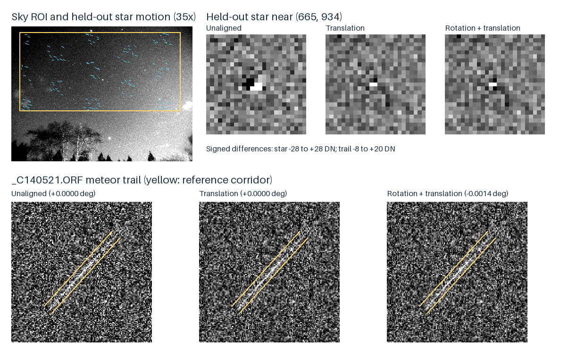

# 恒星による位置合わせを差分の前に適用する試験

組み込みフックでの実行方法とサンプルの検証結果は
[恒星位置合わせ付きの流星検出](star_registration_workflow_ja.md)を参照してください。

## 目的

直前3枚を現在座標に合わせて中央値を取る方式は、[位置合わせ付き中央値背景の比較](registered_median_evaluation_ja.md)で同じRAW系列を使って評価した。

固定カメラの連続RAWでは、隣接露光でも恒星がサブピクセル単位で移動する。明るい恒星を差分にかけると、位置ずれに由来する正負の残差が出る。空のROIにある恒星の位置を使って直前露光を現在露光に合わせると、星の残差を減らせるかを調べた。平行移動だけで十分か、画像面内の回転を加える効果があるかも比較した。天体画像の差分では、位置誤差に加えて点像分布、測光スケール、再標本化による空間相関も残差に影響する。[Zackay・Ofek・Gal-Yam (2016)](https://doi.org/10.3847/0004-637X/830/1/27)

## 方法

- 同梱11ペア、2021GEMINIの35ペア、2024GEMINI後半75ペアのRAWを2×2ビニングした。空の多角形はRAWを見て系列ごとに固定し、木や地上物を避けた。画面端およびROI境界の影響をそろえるため、ROIを16 px収縮して全条件で使用した。参照した6光跡の許容帯が採点範囲内にあることを確認した。
- 空のROIから、ガウシアン差分の局所最大を256 pxタイルごとに最大12点選んだ。局所的なMADで強いピークを選別し、コンパクトさを画素値の二次モーメントで判定した。7×7 pxの重み付き重心をサブピクセル位置とした。直前と現在の双方で最近傍となる12 px以内の点を対応付けた。
- タイルの位置で対応点を推定用と評価用に分けた。推定用の点だけでRANSACにより外れ値を落とし、並進は変位の成分別中央値、回転＋並進はスケール1の剛体変換で推定した。両者は同じRANSACのインライアから求めた。ひとつの画像面内回転であり、天球の回転と広角レンズの投影を明示したモデルは使っていない。
- 直前画像だけを双一次補間で現在の座標に再標本化し、元の現在画像から引いた。点数・分布・最大変位の条件に届かなければ位置合わせなしに戻す設計で、検出結果に基づく切り替えは行わない。推定に使わなかった点で位置の残差を測った。恒星近傍の残差は、同じ評価点を中心とした7×7 px内の絶対差分平均を点ごとに算出した中央値である。空全体については符号付き差分のMAD換算値と絶対差分の99パーセンタイルを記録した。
- ハフとDoG＋LSDは全121ペアに適用した。FRTは軸を注釈した6事象の出現・次ペア、計12ペアに限定した。既存設定と軸被覆率50%以上の照合条件を使った。次ペアでも比較用に元の参照軸を使った。候補の真偽は現在露光の目視ラベルで判定した。計時は各条件1回で、検出器内の時間と位置合わせの時間を分け、RAWの読込と集計を除いた。

## 位置合わせと恒星残差

3系列それぞれについてペアごとの値の中央値を示す。

| 系列 | 位置合わせ | 評価用恒星の位置ずれ（px） | 恒星近傍の絶対差分（DN） | 空の絶対差分 p99（DN） | 回転角の絶対値（°） |
| --- | --- | --- | --- | --- | --- |
| 同梱 | なし | 0.970 | 16.13 | 26 | 0.0000 |
| 同梱 | 平行移動 | 0.212 | 9.59 | 21 | 0.0000 |
| 同梱 | 回転＋平行移動 | 0.211 | 9.59 | 21 | 0.0019 |
| 2021GEMINI | なし | 0.518 | 13.81 | 16 | 0.0000 |
| 2021GEMINI | 平行移動 | 0.193 | 10.48 | 13 | 0.0000 |
| 2021GEMINI | 回転＋平行移動 | 0.177 | 10.37 | 13 | 0.0057 |
| 2024GEMINI後半 | なし | 0.958 | 15.28 | 25 | 0.0000 |
| 2024GEMINI後半 | 平行移動 | 0.222 | 9.08 | 21 | 0.0000 |
| 2024GEMINI後半 | 回転＋平行移動 | 0.222 | 9.10 | 21 | 0.0021 |

位置合わせは121ペアすべてで成立し、評価に使った対応点は1ペアあたり中央値123点だった。前フレームの特徴点を再利用した場合、各ペアでの特徴点抽出と変換推定は中央値59.6 ms、剛体変換での前画像の再標本化は中央値1.1 msだった。全量は実測データに記録した。

異なる評価点で重心の位置ずれが小さくなったことは、再標本化前に確認した幾何学的な改善である。双一次補間は、直前画像の雑音も平滑化する。このため、空全体のMADや残差の減少量には、位置合わせと補間の影響が含まれる。

## 候補と実際の流星

各セルは「候補枚数 / 偽陽性枚数 / 光跡の事象一致」を示す。ハフとDoG＋LSDを同じ空のROIで実行した。先行比較の全画面での候補枚数とは評価範囲が異なる。

| 系列 | 検出器 | 位置合わせなし | 平行移動 | 回転＋平行移動 |
| --- | --- | --- | --- | --- |
| 同梱 | ハフ | 3 / 1 / 2/2 | 4 / 2 / 2/2 | 4 / 2 / 2/2 |
| 同梱 | DoG＋LSD | 3 / 1 / 2/2 | 4 / 2 / 2/2 | 4 / 2 / 2/2 |
| 2021GEMINI | ハフ | 3 / 2 / 1/3 | 5 / 4 / 1/3 | 4 / 3 / 1/3 |
| 2021GEMINI | DoG＋LSD | 2 / 1 / 1/3 | 4 / 3 / 1/3 | 4 / 3 / 1/3 |
| 2024GEMINI後半 | ハフ | 3 / 3 / 0/1 | 5 / 5 / 0/1 | 6 / 6 / 0/1 |
| 2024GEMINI後半 | DoG＋LSD | 0 / 0 / 0/1 | 0 / 0 / 0/1 | 0 / 0 / 0/1 |

FRTは焦点12ペアに限られる。3条件とも出現ペアで6事象すべてが一致した。

後半の淡い流星を含むペアの内訳を示す。中央帯と側帯の差は符号付き差分から求めた。

| 位置合わせ | 恒星近傍の絶対差分（DN） | 流星の符号付き中央帯と側帯の中央値の差（DN） | FRTの流星被覆率 |
| --- | --- | --- | --- |
| なし | 14.88 | 8 | 100% |
| 平行移動 | 9.24 | 8 | 100% |
| 回転＋平行移動 | 9.28 | 7 | 100% |



図は `_C140521.ORF` のRAWを使った。左上の水色の線は推定に使わなかった対応点のうち、変位3 px以下の点を35倍で描いた。右上は比較に用いた恒星1点の拡大、下段は同じ露光の流星光跡で、黄色は参照軸の許容帯を示す。恒星と光跡それぞれのパネルで階調範囲をそろえた。

## 実装上の判断

隣接露光の恒星残差には平行移動が有効だった。回転を加えた場合の位置精度の改善は、2021GEMINIで0.193 pxから0.177 px、他の系列で約0.002 px以内であり、検出事象は増えなかった。ハフの偽陽性は3系列全体で6・11・11枚、DoG＋LSDでは2・5・5枚だった。今回の固定設定では恒星近傍の残差が減っても、候補の削減にはつながらなかった。位置合わせ後の差分を採用する場合は、その差分上で閾値を校正し、偽陽性率をそろえて効果を再評価する。

この処理を検出プラグインに取り込む場合、現在座標に位置合わせした背景と有効マスクを検出器に渡せば、既存の軸や注釈を使える。計測は差分前に現在・直前の両画像を参照できる位置で行う。時間方向の中央値背景に適用するときは、各履歴露光を現在の座標へ一度ずつ直接再標本化してから中央値を取る。今回の計測は隣接露光だけを使った。

## 再現

[全121ペアの変換・残差・検出結果](../experiments/region_comparison/results/star_registration/summary.json)に、入力ハッシュ、ROI座標、各変換行列、評価点の数、判定と時間を記録した。リポジトリのルートで実行する。

```bash
uv sync --locked
run_dir=$(mktemp -d)
uv build --no-sources --wheel --out-dir "$run_dir/dist" experiments/region_comparison
uv pip install --python .venv/bin/python --no-deps \
  --target "$run_dir/plugins" "$run_dir"/dist/*.whl
PYTHONPATH="$run_dir/plugins" .venv/bin/python \
  experiments/region_comparison/benchmark_star_registration.py "$run_dir/results"
PYTHONPATH=.:experiments/region_comparison .venv/bin/python \
  -m unittest discover -s experiments/region_comparison
```
