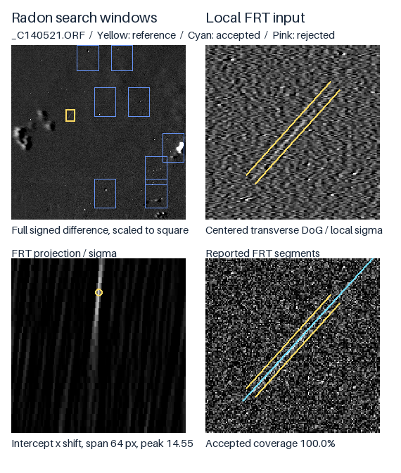
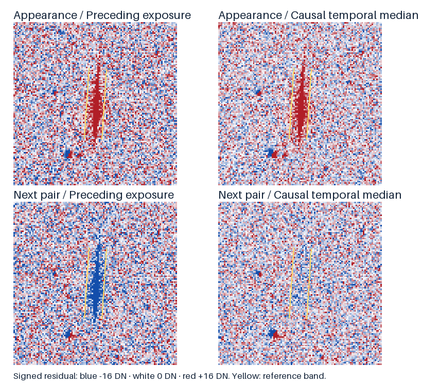
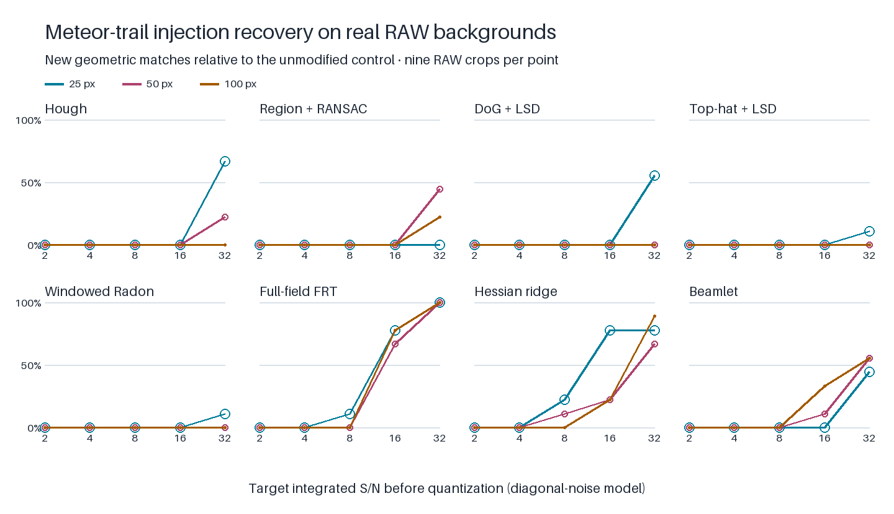
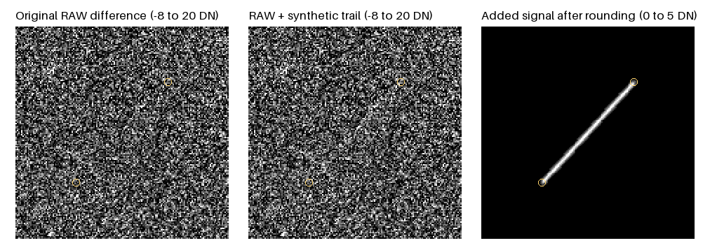

# v2 流星光跡検出器の再評価

RAW系列の全露光を目視したラベルを用い、候補削減と取りこぼしの関係を検証した。2024GEMINIのREADMEには、撮影者が陽性と確認した `_C140521.ORF` を追加した。

| 評価系列 | 評価ペア | 陽性 | 陰性 |
| --- | ---: | ---: | ---: |
| A　同梱 | 11 | 2 | 9 |
| B　2021GEMINI | 35 | 3 | 32 |
| C　2024GEMINI後半 | 75 | 1 | 74 |
| D　2024GEMINI全体 | 327 | 12 | 315 |

各系列の先頭は背景として用い、評価対象外とした。Dには同梱12枚とCの76枚が含まれる。同梱12枚とDの対応ファイルが同一であることをSHA-256で確認した。系列を独立とみなす合算は行わない。各露光の流星の有無は[同梱](../rawfiles/2024GEMINI_AIRCRAFT/README.md)、[2021GEMINI](../rawfiles/2021GEMINI/README.md)、[2024GEMINI](../rawfiles/2024GEMINI/README.md)の各READMEに基づく。

## 判定と計測

- 候補となった現在露光そのものに流星があるとき真陽性と数える。候補となった陰性露光は、前の流星の消失像を含む場合も偽陽性となる。適合率は真陽性数を候補数で割り、再現率は真陽性数を陽性露光数で割る。流星のある露光を1枚回収するのに必要な確認枚数は、候補枚数を真陽性数で割った値とした。分母が0の指標は未定義とした。
- 幾何学的な一致は、参照軸と15°以内の角度差にある出力線分が参照帯内で覆った長さの割合を用いた。出現ペアまたは次ペアで候補かつ被覆率50%以上なら1事象と数える。Dの陽性12枚のうち軸注釈がある3枚だけを幾何学的な一致の分母とした。
- 固定した従来設定で、既存の検出プラグインに同じ2×2ビニング済みRAW、全画面ROIを渡した。フックとファイルコピーは使っていない。A〜Cの従来判定の比較ではペアと反復ごとに方式の実行順をずらし、検出器内の全ペア分を計3回測定した。表にはその中央値を示す。検出器の内部処理に含まれるハフの候補の診断画像は計時対象である。macOS arm64、Python 3.14.10、OpenCV 5.0.0、NumPy 2.5.5を使用した。プラグインの呼び出しは逐次実行し、実行環境のOpenCV内部スレッド設定は10だった。RAWの読込、報告と成果物の保存はこの計時に含めない。同一手順を用いたD・共通判定・中央値背景・探索入力の雑音正規化の試験は各1回である。

## 従来設定の再測定

| 系列 | 検出器 | 候補 | TP | FP | FN | TN | 適合率 | 再現率 | 事象一致 | 検出器内（秒） |
| --- | --- | --- | --- | --- | --- | --- | --- | --- | --- | --- |
| A | ハフ | 11 | 2 | 9 | 0 | 0 | 18.2% | 100.0% | 2/2 | 0.09 |
| A | 領域 | 2 | 2 | 0 | 0 | 9 | 100.0% | 100.0% | 2/2 | 4.77 |
| A | DoG＋LSD | 11 | 2 | 9 | 0 | 0 | 18.2% | 100.0% | 2/2 | 1.54 |
| A | トップハット＋LSD | 11 | 2 | 9 | 0 | 0 | 18.2% | 100.0% | 2/2 | 3.59 |
| A | 限定ラドン | 11 | 2 | 9 | 0 | 0 | 18.2% | 100.0% | 2/2 | 1.32 |
| A | 全画面FRT | 11 | 2 | 9 | 0 | 0 | 18.2% | 100.0% | 2/2 | 18.84 |
| B | ハフ | 31 | 3 | 28 | 0 | 4 | 9.7% | 100.0% | 1/3 | 0.37 |
| B | 領域 | 14 | 3 | 11 | 0 | 21 | 21.4% | 100.0% | 3/3 | 2.44 |
| B | DoG＋LSD | 25 | 2 | 23 | 1 | 9 | 8.0% | 66.7% | 1/3 | 4.42 |
| B | トップハット＋LSD | 26 | 3 | 23 | 0 | 9 | 11.5% | 100.0% | 1/3 | 7.02 |
| B | 限定ラドン | 35 | 3 | 32 | 0 | 0 | 8.6% | 100.0% | 1/3 | 3.70 |
| B | 全画面FRT | 35 | 3 | 32 | 0 | 0 | 8.6% | 100.0% | 3/3 | 62.26 |
| C | ハフ | 66 | 1 | 65 | 0 | 9 | 1.5% | 100.0% | 0/1 | 0.81 |
| C | 領域 | 4 | 0 | 4 | 1 | 70 | 0.0% | 0.0% | 0/1 | 32.10 |
| C | DoG＋LSD | 40 | 1 | 39 | 0 | 35 | 2.5% | 100.0% | 0/1 | 10.42 |
| C | トップハット＋LSD | 28 | 0 | 28 | 1 | 46 | 0.0% | 0.0% | 0/1 | 24.12 |
| C | 限定ラドン | 40 | 0 | 40 | 1 | 34 | 0.0% | 0.0% | 0/1 | 8.87 |
| C | 全画面FRT | 75 | 1 | 74 | 0 | 0 | 1.3% | 100.0% | 1/1 | 125.74 |

出現ペアの参照軸の被覆率を示す。事象一致には、この被覆率に加えて候補判定の条件を適用する。

| 出現時の露光 | ハフ | 領域 | DoG＋LSD | トップハット＋LSD | 限定ラドン | 全画面FRT |
| --- | --- | --- | --- | --- | --- | --- |
| `_C140338.ORF` | 94.8% | 100.0% | 99.9% | 78.3% | 99.8% | 100.0% |
| `_C140344.ORF` | 63.4% | 100.0% | 84.3% | 51.1% | 79.4% | 100.0% |
| `_C150303.ORF` | 88.7% | 75.3% | 91.3% | 80.0% | 81.5% | 100.0% |
| `_C150319.ORF` | 0.0% | 90.2% | 0.0% | 0.0% | 0.0% | 100.0% |
| `_C150326.ORF` | 0.0% | 91.3% | 0.0% | 0.0% | 0.0% | 100.0% |
| `_C140521.ORF` | 0.0% | 0.0% | 0.0% | 0.0% | 0.0% | 100.0% |

| 2024GEMINI全体 | 候補 | TP | FP | FN | TN | 適合率 | 再現率 | 陽性1枚あたりの候補 | 検出器内（秒） |
| --- | --- | --- | --- | --- | --- | --- | --- | --- | --- |
| ハフ | 277 | 11 | 266 | 1 | 49 | 4.0% | 91.7% | 25.18 | 3.72 |
| 領域 | 33 | 6 | 27 | 6 | 288 | 18.2% | 50.0% | 5.50 | 143.56 |

Dで領域方式が残した33枚はすべてハフの候補にも含まれた。ハフだけが残した244枚の内訳は陰性239枚と陽性5枚で、`_C140275.ORF` は両方式が取りこぼした。陽性露光1枚を回収するのに確認する枚数は25.2枚から5.5枚、露光単位の再現率は91.7%から50.0%になった。

Cでハフだけが選んだ62枚は陰性61枚、陽性1枚だった。領域方式は陰性の確認対象を65枚から4枚へ減らす一方、唯一の陽性露光 `_C140521.ORF` を外した。ハフでも光跡被覆率は0%で、露光の回収と光跡の検出は一致しなかった。陽性が1枚なので、独立な試行を仮定した正確95%区間も広い（1/1で2.5〜100%、0/1で0〜97.5%）。A・C・Dの撮影条件は重複し、A・Bは設定選択に使った。

全画面FRTはCの75枚すべてを候補とし、適合率は1.3%、再現率は1/1だった。限定ラドンでは参照光跡が8つの探索窓の外にあり、被覆は0%であった。全画面FRTでの被覆は100%だったが、約172 pxの採用線分は約99.8 pxの参照軸よりも長い。実測の投影図には、短い積算区間で得点14.55だった位置も示す。



ヘッセ行列によるリッジ検出とBeamletの既存ログは、入力RAWのハッシュと軸注釈が今回の比較と一致することを確認して再集計した。保存済みの幾何学的な被覆は出現ペアについて示す。この表には別試行の時間を含めていない。

| 系列 | 検出器 | 候補 | TP | FP | 出現ペアでの一致 |
| --- | --- | --- | --- | --- | --- |
| A | ヘッセ行列リッジ | 11 | 2 | 9 | 2/2 |
| A | Beamlet | 11 | 2 | 9 | 2/2 |
| B | ヘッセ行列リッジ | 35 | 3 | 32 | 2/3 |
| B | Beamlet | 35 | 3 | 32 | 1/3 |
| C | ヘッセ行列リッジ | 75 | 1 | 74 | 0/1 |
| C | Beamlet | 75 | 1 | 74 | 0/1 |

## 共通の線分検証と雑音正規化

方式固有の前処理、探索範囲、候補形状の生成を保ち、最終採否の代わりに同じ検証を実行した。限界は元の探索で生じる。例えば限定ラドンの探索範囲を最終判定から広げることはできない。各候補線分に沿って約1 px間隔で中央帯（±1 px）の符号付き残差を測り、正の標本が75%以上の線分を残した。側帯（±6〜8 px）の中央値との差を5標本の移動平均で平滑化し、閾値以上かつ中央帯が正の状態が45 px以上途切れない区間を採用した。固定閾値9 DNと、局所雑音尺度の2倍を比較した。局所雑音尺度は64 pxタイルで標本化した符号付き残差のMADの1.4826倍で、下限を1 DNとした。局所雑音による規格化は最終検証だけに適用したため、各方式の探索段階のDN閾値は残る。

各セルは、候補枚数、真陽性の露光枚数、幾何学的な事象一致数を示す。

| 検出器 | A 従来 | A 9 DN | A 2σ | B 従来 | B 9 DN | B 2σ | C 従来 | C 9 DN | C 2σ |
| --- | --- | --- | --- | --- | --- | --- | --- | --- | --- |
| ハフ | 11 / 2 / 2件（2件中） | 3 / 1 / 1件（2件中） | 3 / 1 / 1件（2件中） | 31 / 3 / 1件（3件中） | 4 / 1 / 1件（3件中） | 4 / 1 / 1件（3件中） | 66 / 1 / 0件（1件中） | 23 / 0 / 0件（1件中） | 5 / 0 / 0件（1件中） |
| 領域 | 2 / 2 / 2件（2件中） | 2 / 2 / 2件（2件中） | 1 / 1 / 1件（2件中） | 14 / 3 / 3件（3件中） | 4 / 1 / 1件（3件中） | 4 / 1 / 1件（3件中） | 4 / 0 / 0件（1件中） | 0 / 0 / 0件（1件中） | 0 / 0 / 0件（1件中） |
| DoG＋LSD | 11 / 2 / 2件（2件中） | 8 / 1 / 1件（2件中） | 6 / 1 / 1件（2件中） | 25 / 2 / 1件（3件中） | 3 / 1 / 1件（3件中） | 3 / 1 / 1件（3件中） | 40 / 1 / 0件（1件中） | 0 / 0 / 0件（1件中） | 0 / 0 / 0件（1件中） |
| トップハット＋LSD | 11 / 2 / 2件（2件中） | 7 / 2 / 0件（2件中） | 5 / 1 / 0件（2件中） | 26 / 3 / 1件（3件中） | 2 / 1 / 1件（3件中） | 2 / 1 / 1件（3件中） | 28 / 0 / 0件（1件中） | 0 / 0 / 0件（1件中） | 0 / 0 / 0件（1件中） |
| 限定ラドン | 11 / 2 / 2件（2件中） | 2 / 1 / 1件（2件中） | 2 / 1 / 1件（2件中） | 35 / 3 / 1件（3件中） | 4 / 1 / 1件（3件中） | 3 / 1 / 1件（3件中） | 40 / 0 / 0件（1件中） | 4 / 0 / 0件（1件中） | 3 / 0 / 0件（1件中） |
| 全画面FRT | 11 / 2 / 2件（2件中） | 9 / 2 / 2件（2件中） | 9 / 2 / 1件（2件中） | 35 / 3 / 3件（3件中） | 4 / 1 / 1件（3件中） | 4 / 1 / 1件（3件中） | 75 / 1 / 1件（1件中） | 37 / 1 / 0件（1件中） | 7 / 0 / 0件（1件中） |

同梱の短い光跡では、従来判定のDoG＋LSDと限定ラドンの被覆は84.3%、79.4%だった。共通判定を適用すると、両閾値とも被覆は0%になった。Bでは領域方式とFRTの事象一致が3/3から1/3に減った。陰性候補の減少に加え、実際の光跡の棄却も生じた。Cの全画面FRTでは、共通の2σ判定で候補が75枚から7枚になり、唯一の陽性露光も外れた。9 DN判定では37枚の候補にこの露光が含まれたが、光跡被覆は0%だった。75ペアの符号付き差分と雑音タイルの準備に2.47秒、FRTの全候補を2つの閾値で検証するのに合計24.37秒を要した。

### 探索前の入力の雑音正規化

探索前に符号付き差分を局所雑音尺度で標準化する試験も別に行った。タイル中心間を補間したMAD尺度で各画素の差分を割り、雑音尺度1単位を整数の解析値4.5単位に対応させた。未処理入力に対する9、15の閾値は、丸め前の換算でそれぞれ局所雑音尺度の約2倍、3.33倍になる。LSDの70の上限は標準化後のフィルタ応答に対して適用する。入力尺度での換算値は15.56で、フィルタ後の雑音標準偏差とは区別する。各方式の最終判定は従来のまま、同じRAWと固定設定で比較した。

矢印は「元のDN尺度 → 雑音で標準化した入力」を示す。

| 系列 | 検出器 | 候補 | 真陽性の露光 | 事象一致 |
| --- | --- | --- | --- | --- |
| A | ハフ | 11 → 11 | 2 → 2 | 2 → 1 / 2 |
| A | 領域 | 2 → 3 | 2 → 2 | 2 → 2 / 2 |
| A | DoG＋LSD | 11 → 11 | 2 → 2 | 2 → 1 / 2 |
| A | トップハット＋LSD | 11 → 11 | 2 → 2 | 2 → 1 / 2 |
| A | 限定ラドン | 11 → 11 | 2 → 2 | 2 → 1 / 2 |
| B | ハフ | 31 → 32 | 3 → 3 | 1 → 1 / 3 |
| B | 領域 | 14 → 8 | 3 → 2 | 3 → 2 / 3 |
| B | DoG＋LSD | 25 → 20 | 2 → 2 | 1 → 1 / 3 |
| B | トップハット＋LSD | 26 → 24 | 3 → 2 | 1 → 1 / 3 |
| B | 限定ラドン | 35 → 35 | 3 → 3 | 1 → 1 / 3 |
| C | ハフ | 66 → 36 | 1 → 0 | 0 → 0 / 1 |
| C | 領域 | 4 → 10 | 0 → 0 | 0 → 0 / 1 |
| C | DoG＋LSD | 40 → 6 | 1 → 0 | 0 → 0 / 1 |
| C | トップハット＋LSD | 28 → 5 | 0 → 0 | 0 → 0 / 1 |
| C | 限定ラドン | 40 → 5 | 0 → 0 | 0 → 0 / 1 |

探索前に標準化すると、Bの領域方式は候補14枚から8枚になり、事象一致は3/3から2/3に減った。Cでは標準化を試した5方式すべてが陽性露光を候補から外した。同じ雑音倍率への換算でも、方式ごとに候補の数と位置が変わった。

## 時間方向の中央値背景

恒星を合わせてから差分を取る場合の効果は、同じ121ペアで実施した[恒星による位置合わせの試験](star_registration_evaluation_ja.md)に示す。

現在露光と直前露光との差分を、現在露光と直前3枚の画素ごとの中央値との差分に置き換えた。画像の位置合わせや未来の露光は使用していない。追加の履歴に必要な先頭2ペアは、基準側からも除いて比較した。

矢印は「直前露光との差分 → 中央値背景との差分」を示す。同じ9、33、73ペアで比較した。

| 系列 | 検出器 | 候補 | 真陽性の露光 | 事象一致 | 次ペアでの一致 |
| --- | --- | --- | --- | --- | --- |
| A | ハフ | 9 → 9 | 2 → 2 | 2 → 2 / 2 | 2 → 0 |
| A | 領域 | 2 → 4 | 2 → 2 | 2 → 2 / 2 | 0 → 0 |
| A | DoG＋LSD | 9 → 9 | 2 → 2 | 2 → 1 / 2 | 1 → 0 |
| A | 限定ラドン | 9 → 9 | 2 → 2 | 2 → 2 / 2 | 2 → 0 |
| A | 全画面FRT | 9 → 9 | 2 → 2 | 2 → 2 / 2 | 0 → 0 |
| B | ハフ | 29 → 30 | 3 → 3 | 1 → 1 / 3 | 1 → 0 |
| B | 領域 | 14 → 13 | 3 → 3 | 3 → 3 / 3 | 0 → 0 |
| B | DoG＋LSD | 23 → 24 | 2 → 2 | 1 → 1 / 3 | 1 → 0 |
| B | 限定ラドン | 33 → 33 | 3 → 3 | 1 → 1 / 3 | 1 → 0 |
| B | 全画面FRT | 33 → 33 | 3 → 3 | 3 → 3 / 3 | 0 → 0 |
| C | ハフ | 64 → 66 | 1 → 1 | 0 → 0 / 1 | 0 → 0 |
| C | 領域 | 4 → 11 | 0 → 0 | 0 → 0 / 1 | 0 → 0 |
| C | DoG＋LSD | 40 → 52 | 1 → 0 | 0 → 0 / 1 | 0 → 0 |
| C | 限定ラドン | 39 → 48 | 0 → 0 | 0 → 0 / 1 | 0 → 0 |
| C | 全画面FRT | 73 → 73 | 1 → 1 | 1 → 1 / 1 | 0 → 0 |

Aではハフと限定ラドンで次ペアの一致が2件から0件になり、出現ペアの2件は維持された。DoG＋LSDでは同梱の短い光跡の出現ペアの一致を失った。Bでは領域方式が事象一致3/3を保ち、候補を14枚から13枚に減らした。Cでは中央値背景でも全画面FRTの被覆率は100%で、評価対象73枚すべてが候補になった。領域方式は4枚から11枚に増え、唯一の陽性露光は引き続き候補外だった。中央値背景は一部の消失像を抑えたが、背景の変化で別の残差が生じるため、総候補数は方式によって増えた。



`_C140344.ORF` の正の出現像はどちらの背景でも残る。次ペアに生じる負の光跡は、中央値背景を使うと抑えられた。

## 疑似光跡の回収試験

A〜Cから前後とも陰性の異なるペアを3組ずつ選び、768 px角の切り出しを使用した。均一な有限線分を等方ガウスの点像分布関数（標準偏差1.2 px）でぼかして現在露光に加えた。長さ25・50・100 px、目標積算S/N 2・4・8・16・32について位置と向きを変えた。さらに長さ100 px・ピーク5 DNの光跡を、Cの参照光跡に近い角度で置いた。目標S/Nは局所雑音尺度で割ったテンプレートのノルムであり、整数DNへの丸め後の実現値も記録した。注釈と同じ角度差・被覆率条件で照合し、同じ位置に光跡を加えない対照でも一致した試行を新規回収から除いた。FRTの投影得点とは定義が異なり、空間相関や光子雑音の増分はモデル化していない。

目標S/N 32と、長さ100 px・ピーク5 DNでの新規回収を示す。最終列は5 DNを加える前の実RAW差分で、同じ位置の参照光跡に一致した試行である。

| 検出器 | S/N 32・25 px | S/N 32・50 px | S/N 32・100 px | 5 DN・100 px | 5 DNを加える前の一致 |
| --- | --- | --- | --- | --- | --- |
| ハフ | 6/9 | 2/9 | 0/9 | 0/9 | 0 |
| 領域 | 0/9 | 4/9 | 2/9 | 0/9 | 0 |
| DoG＋LSD | 5/9 | 0/9 | 0/9 | 0/9 | 0 |
| トップハット＋LSD | 1/9 | 0/9 | 0/9 | 0/9 | 0 |
| 限定ラドン | 1/9 | 0/9 | 0/9 | 0/9 | 0 |
| 全画面FRT | 9/9 | 9/9 | 9/9 | 1/9 | 0 |
| ヘッセ行列リッジ | 7/9 | 6/9 | 8/9 | 1/9 | 0 |
| Beamlet | 4/9 | 5/9 | 5/9 | 1/9 | 0 |

目標積算S/N 16では全画面FRTが25・50・100 pxの順に7/9、6/9、7/9を新規回収した。目標S/N 32では全長で9/9だった。100 px・ピーク5 DNはFRT、ヘッセ行列リッジ、Beamletがそれぞれ1/9で、丸め後の実現S/Nは5.63〜16.39だった。実流星 `_C140521.ORF` の5 DNは中央値の差で、疑似光跡のピーク値とは測り方が異なる。





各曲線の点は9領域に基づき、条件間で背景を再利用している。切り出しは探索範囲と限定ラドンの窓選択に影響する。曲線と実RAW上の再現率は区別する。

## 再現手順

リポジトリのルートで実行する。実測結果は[ペア別評価と時間](../experiments/region_comparison/results/v2_reviewed/measurements.json)、[疑似光跡144試行のデータ](../experiments/region_comparison/results/v2_reviewed/injections.json)に保存した。READMEと入力RAWのハッシュ、各ペアの判定、被覆率、陽性・陰性の集計を記録している。検出器は実験用ホイール0.11.0を使用した。

```bash
uv sync --locked
run_dir=$(mktemp -d)
uv build --no-sources --wheel --out-dir "$run_dir/dist" experiments/region_comparison
uv pip install --python .venv/bin/python --no-deps \
  --target "$run_dir/plugins" "$run_dir"/dist/*.whl
export PYTHONPATH="$run_dir/plugins"
experiments=experiments/region_comparison
.venv/bin/python "$experiments/benchmark_v2.py" "$run_dir/meteor-v2-original" \
  --sequences bundled gemini2021 late2024 \
  --methods hough region dog_lsd tophat_lsd radon frt --repeats 3
.venv/bin/python "$experiments/benchmark_v2.py" "$run_dir/meteor-v2-full" \
  --sequences full2024 --methods hough region
.venv/bin/python "$experiments/benchmark_v2.py" "$run_dir/meteor-v2-common" \
  --sequences bundled gemini2021 late2024 \
  --methods hough region dog_lsd tophat_lsd radon frt --common-verifier
.venv/bin/python "$experiments/benchmark_v2.py" "$run_dir/meteor-v2-median" \
  --sequences bundled gemini2021 late2024 \
  --methods hough region dog_lsd radon frt --temporal-median
.venv/bin/python "$experiments/benchmark_v2.py" "$run_dir/meteor-v2-noise-scaled" \
  --sequences bundled gemini2021 late2024 \
  --methods hough region dog_lsd tophat_lsd radon --noise-scaled
.venv/bin/python "$experiments/review_metrics.py" "$run_dir/measurements.json" \
  "$run_dir/meteor-v2-original" "$run_dir/meteor-v2-full" "$run_dir/meteor-v2-common" \
  "$run_dir/meteor-v2-median" "$run_dir/meteor-v2-noise-scaled"
.venv/bin/python "$experiments/inject_v2.py" "$run_dir/injection"
.venv/bin/python "$experiments/plot_injection_recovery.py" \
  "$run_dir/injection/injections.json" "$run_dir/injection/recovery.png"
.venv/bin/python "$experiments/plot_median_background.py" "$run_dir/median-background.png"
PYTHONPATH=.:experiments/region_comparison .venv/bin/python \
  -m unittest discover -s experiments/region_comparison
```
